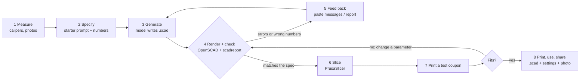
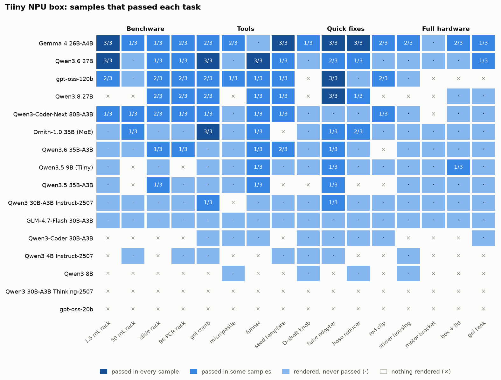
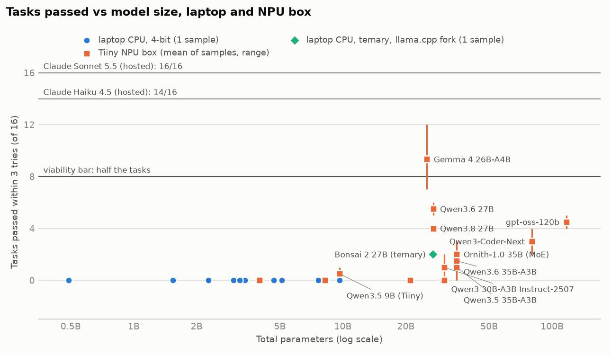

# Prompt to Bench: language models as a no-CAD entry point to 3D printing for biology labs

[](https://doi.org/10.5281/zenodo.23198097)

**Sebastian S. Cocioba** ([ORCID 0000-0002-6821-2996](https://orcid.org/0000-0002-6821-2996); [@ATinyGreenCell](https://github.com/ATinyGreenCell)), Binomica Labs, and contributors

*Living preprint, v0.4.0 (22 October 2026; it adds the finished NPU-box sweep, seven cheaper fixes for small models ([§6.6](#66-cheaper-fixes-for-small-models)) and 16 new held-out tasks ([§6.7](#67-new-tasks))). This README **is** the paper. Corrections, tasks, designs, models and languages are welcome; see [How to contribute](#how-to-contribute). How it was built, prompt by prompt, is in the [build log](meta/BUILD_LOG.md).*

> **New to AI or CAD?** The [terms used in this paper](#terms) are explained after the abstract.
>
> **In this repository:** the paper (this page) · [student tutorial](tutorial/README.md) and [setup guide](tutorial/SETUP.md) · [16 parametric OpenSCAD lab designs](designs/) · [the Prompt-to-Bench benchmark](bench/) · [`scadreport`](tools/scadreport.py), a geometry-feedback tool for any chatbot · [audits](meta/audits/) · licences: text CC BY 4.0, designs CERN-OHL-P-2.0, code MIT.

---

## Abstract

Biology labs run on small plastic parts: tube racks, gel combs, adapters, knobs and brackets. A desktop 3D printer makes them for cents, but designing them has required CAD (computer-aided design) skills that most biologists never learn. Language models lower that barrier when the design is written as code: the user describes a part in words and measured numbers, the model writes the design as a short program in OpenSCAD, free CAD software, and the user renders, checks and prints it. We describe this workflow and the practices that make it reliable, and release 16 parametric lab designs (33.7 h and about US$13 of PLA to print), a benchmark that scores model-written designs against hidden geometric checks, and a tool that tells a model what its code actually built. Two of Anthropic's hosted models, used over the internet, passed nearly every task: Claude Sonnet 5.5 all 16 on the first try, Claude Haiku 4.5 14 of 16 within three attempts. None of 14 off-the-shelf open-weight models, which anyone can download and run offline, passed a task on a 2022 laptop without a graphics card; a larger, 27-billion-parameter model compressed to fit the same laptop passed 2 of the 16, at a median of 24 minutes a task. On a small desktop computer built to run AI models (an NPU box, bought for US$1,300 at its Kickstarter early-bird price), the open Gemma 4 26B passed 7-12 of the 16 tasks within three attempts in each of three repeat runs, about half (about 3 on the first try), at 2.4 minutes a task. Further training on verified example parts (fine-tuning), better prompts, and seven cheaper fixes tested under a protocol written in advance made more of the small models' code build, but none brought a laptop-sized model near usefulness. The fine-tuned models largely ignored error feedback; trained on their own failed attempts, they used it again but still rarely fixed a part. On 16 new tasks, written by a separate AI session before any model was run on them, Claude Sonnet 5.5 again passed all 16, as did Claude Opus 5.5, but every other model that had passed tasks passed fewer (Haiku 10 instead of 14; Gemma 4 26B 4 per run instead of 9.3), and a prompt that had more than doubled Gemma's first-try passes on the original tasks did not help on the new ones. The new requests ask for more: request length alone predicts about 60% of the drop. All 37 near-misses (failed parts that missed only one check, or met at least 80% of them) departed from the request, 30 in a way that would stop the part working, often a spatial one such as a cone upside down. Today a hosted model is the reliable path; an open model on dedicated hardware passes about half of our original tasks and a quarter of new ones, at a usable speed; laptop models are not yet usable design assistants. We have not yet tested other hosted chatbots or free versions of them, nor the workflow with people who lack CAD experience, and a first set of parts to print and measure is ready but not yet printed.

**What this means for your lab.**

- Use a hosted model if you can: Claude Sonnet 5.5 passed all 16 tasks on the first try (and all 16 new ones), and Claude Haiku 4.5 passed 14 within three attempts (10 of the new ones). We did not test other hosted chatbots, such as ChatGPT or Gemini, or free versions of any.
- Whatever the model, give measured numbers, the print orientation and the coordinate frame (for example, "the base lies on the bed at z = 0"); check what the model built against your request with `scadreport`; and print a small test piece before the whole part ([§3](#3-the-workflow), [§4](#4-best-practices)).
- Offline on an ordinary laptop, no open-weight model is yet a design assistant: the best passed 2 of 16 tasks, at a median of 24 minutes a task.
- On a US$1,300 NPU box, the open Gemma 4 26B passed about half of our original tasks within three attempts (about a fifth on the first try) and about a quarter of new ones, so check every part.
- Start from the 16 lab-ready designs in [`designs/`](designs/) and change their numbers rather than asking for a new design.

**Reading the numbers.** An *attempt* is one reply with one design file. A *conversation* is one task given to one model: up to three attempts, with feedback after each failure. *Passed within three attempts* means one of them met every hidden check; because the hidden checks decided when to send feedback, a user working alone would do somewhat worse. A *sample* is one complete run of a model over all the tasks, so *per sample* means per run; *pass@8* counts a task as passed if any of eight samples passed it, which only the hidden checks can tell. A file that *renders* (or *builds*) produced a 3D shape, right or wrong; a *pass* means the shape matched the request.

<a id="terms"></a>
<details>
<summary><b>New to AI or CAD? Terms used in this paper</b> (click to expand)</summary>

**Language models and how they run**

| Term | Meaning here |
|---|---|
| Language model | A program trained on large amounts of text that writes text, including code, in reply to a request. ChatGPT and Claude are examples. |
| Hosted model | A model that runs on its company's servers and is used over the internet, usually for a fee (here Anthropic's Claude Haiku 4.5, Sonnet 5.5 and Opus 5.5). |
| Open-weight model | A model whose trained files (its *weights*) anyone can download and run on their own computer, offline. Licences vary: open-weight is not the same as open source. |
| Parameters (B) | The numbers a model learned in training; "7B" means 7 billion. More parameters usually means a more capable model that needs more memory. |
| Mixture of experts (MoE), active parameters | A model that uses only part of its parameters for each word it writes (for example 30B in total, 3B *active*), so it runs about as fast as a much smaller model but still needs memory for all of it. Such models are also called *sparse*; a *dense* model uses all its parameters. |
| Quantised, 4-bit, ternary | Weights stored with fewer digits, so that the model fits in less memory at some cost in quality. 4-bit (Q4_K_M) is the usual choice on laptops; a ternary model stores almost every weight as -1, 0 or +1. |
| Token | The unit a model reads and writes, roughly three-quarters of an English word. Reply limits ("a 2,048-token cap") and speeds ("tokens per second") are counted in tokens. (In *token Jaccard*, below, a token is simply a word or a number.) |
| Context | How much text, in tokens, a model can take into account at once: the instructions, the request, its earlier replies and the feedback. |
| Reasoning ("thinking") | Some models write out a long chain of reasoning before they answer. It can help, but it takes time, and it can use up the reply limit before the answer is written (the reply is then "cut off"). |
| Prompt, system prompt, harness | The prompt is the text a model is given. The system prompt holds standing instructions sent before every request. The harness is the program that sends the prompts, collects the code, renders it and sends feedback; in §6.4, the harnesses h0-h4 are packages of a prompt and its feedback. |
| Temperature, top-p, seed | Settings for randomness (temperature here is the model's, not the printer's). Temperature and top-p set how freely the model varies its word choices (we used 0.2 and 0.95, fairly conservative); a seed fixes the random choices so that a run can be repeated. In §6.4, "v9, seed 1" is v9's training repeated with another random seed. |
| Sample | One complete run of a model on all 16 tasks (not a biological sample). Results vary from run to run, so we often report several samples. |
| Fine-tuning, LoRA, epoch | Further training of an existing model on one's own examples. LoRA (and QLoRA, its low-memory form) trains a small add-on instead of the whole model, so here a few hours on one rented graphics card sufficed. An epoch is one pass through the training examples. |
| Synthetic, distilled, rejection sampling | Synthetic training examples are made by a program; distilled ones were written by a stronger model (Claude Opus); rejection sampling keeps only the model's own answers that pass a check, and trains on those. |
| CPU, GPU, NPU | The CPU is a computer's ordinary processor. A GPU (graphics card) and an NPU (neural processing unit) are chips that run models much faster; the "NPU box" is a small desktop computer built around one. |
| Ollama, llama.cpp, vLLM | Free programs that run open-weight models: Ollama (built on llama.cpp) on ordinary computers, vLLM on rented GPUs. |
| Hugging Face, GGUF, safetensors | Hugging Face is the main public site for sharing open-weight models. GGUF (used by Ollama and llama.cpp) and safetensors (used by most other tools) are file formats for a model's weights. |

**CAD and 3D printing**

| Term | Meaning here |
|---|---|
| CAD | Computer-aided design: software for designing parts in 3D. |
| OpenSCAD | Free CAD software in which a part is written as a short program: solids such as cubes and cylinders, placed, added together and cut from each other, with every size a named number. |
| Parametric | A design whose sizes are named numbers (for example `tube_d = 11.2`) that can be changed to make a new version without redrawing it. OpenSCAD's Customizer is a panel for changing them. |
| Render | Turn the program into a 3D shape. A file that "renders" produced a solid, right or wrong; one that does not has an error. |
| Boolean operations, cutter | Combining solids: union (add), difference (cut one out of another) and intersection (keep the overlap). A hole is made by subtracting a cylinder, the *cutter*. |
| Mesh, STL, watertight | The rendered part is a surface made of triangles, saved as an STL file. It is watertight (or *manifold*) when that surface is closed, with no gaps, as a printable solid must be. |
| Bounding box | The smallest box that contains the part: its overall length, width and height. |
| Slicer, G-code | The slicer (here PrusaSlicer) cuts a part into layers and writes G-code, the printer's instructions; it also estimates the print time and the plastic used. |
| Bed, print orientation | The bed is the printer's build plate. The print orientation is which face of the part lies on it; in our requests that face is at height z = 0. |
| Coordinate frame | Where the part sits and which way it faces along the design's x, y and z axes, stated in the request (for example, "the base lies on the bed at z = 0"). |
| Overhang, bridge, supports | An overhang leans out over empty space; a bridge spans a gap in mid-air. Steep overhangs (beyond about 45°) and long bridges need printed supports, which our designs avoid. |
| FDM, PLA, PETG | FDM printers build a part from melted plastic filament, layer by layer. PLA and PETG are common filaments; PLA softens at about 55-60 °C. |
| Coupon | A small test print of only the critical feature, such as a few holes, to check the fit before printing the whole part. |

**The benchmark and the statistics**

| Term | Meaning here |
|---|---|
| Task, check, pass | A task is one design request. Hidden checks measure the rendered part: its size, holes, slots, positions and volume. A part passes only if it meets every check. |
| Attempt, conversation, feedback | A model gets up to three attempts at each task, in one conversation. After a failed attempt it is shown OpenSCAD's error messages or a measurement report of the part it built (from `scadreport`), never the checks. |
| First try, within three attempts | Whether the first attempt passed, or any of the three. |
| Near-miss | A failed part that missed only one check, or met at least 80% of them ([§6.7](#67-new-tasks)). |
| pass@8 | Whether at least one of eight samples passed a task. |
| Held out | Not used to develop or choose a method, so that it can test whether the method works on new parts. HO-16 is a held-out set of 16 new tasks. |
| In-family, out-of-family | In §6.4, the eight original tasks whose descriptions one round's training data turned out to paraphrase, and the other eight. |
| Pre-registered | The test, and how it would be judged, was written down before its results were seen. |
| Token Jaccard | How much two texts overlap: the share of the distinct words and numbers in either that both contain (0% means nothing in common). |
| 95% interval (Wilson) | A 95% confidence interval for a pass rate: 14 of 16 tasks passed gives 64-97%. |
| Fisher's exact test, McNemar's test, sign test | Tests of whether two pass rates differ. McNemar's test and the sign test compare the same tasks under two conditions. |
| Spearman's ρ | A rank correlation, from -1 to 1. |
| Logistic model, odds ratio | A regression for yes-or-no outcomes such as pass or fail. An odds ratio below 1 means lower odds of passing. |
| Precision | Of the parts a test accepted, the share that were actually right. |
| ± | In §6.4, the expected number of tasks a fresh set of eight samples would pass, plus or minus one standard deviation. |

</details>

---

## 1. Introduction

Every biology lab depends on a long tail of small, specific objects: a rack for the tubes this lab actually uses, a comb for a home-made gel tray, an adapter between two consumables, a replacement for the knob that cracked. Commercial versions are expensive, slow to arrive or not made at all. A decade of "open labware" has shown that printed and open-source equipment can match commercial tools at a fraction of the cost ([Pearce 2012](#pearce2012); [Baden et al. 2015](#baden2015); [Coakley & Hurt 2016](#coakley2016); [Pearce 2020](#pearce2020)), and that it matters most where budgets and supply chains are thinnest ([Maia Chagas 2018](#maiachagas2018); [Wenzel 2023](#wenzel2023)). In one collection of 26 printable lab items, which this author co-wrote, printed versions cost on average 8.18% of their commercial equivalents ([McNair et al. 2024](#mcnair2024)).

The printer is no longer the bottleneck; design is. One of the most widely used scripting tools for parametric open labware is **OpenSCAD** ([OpenSCAD developers](#openscad); [Machado et al. 2019](#machado2019)), in which a part is a short program of solids, Boolean operations and loops. It underlies the OpenFlexure microscope ([Collins et al. 2020](#collins2020)), the FlyPi ([Maia Chagas et al. 2017](#maiachagas2017)), a syringe-pump library ([Wijnen et al. 2014](#wijnen2014)), printable optics ([Zhang et al. 2013](#zhang2013)) and a steady stream of recent biology tools ([Subbaraman et al. 2024](#subbaraman2024); [Keene-Snickers et al. 2025](#keenesnickers2025); [Yamazaki et al. 2025](#yamazaki2025); [Bhupathi et al. 2026](#bhupathi2026); [Algarín et al. 2026](#algarin2026)). Its users find spatial reasoning, validation and debugging the hard parts ([Gonzalez Avila et al. 2024](#gonzalezavila2024)).

Because OpenSCAD designs are text, a language model can draft them from a plain-language description. GPT-4 has been used this way for microfluidic components ([Nelson et al. 2023](#nelson2023)), benchmarks of frontier models find OpenSCAD among the most reliable code-CAD formats ([Jones et al. 2025](#jones2025); [Yang et al. 2026a](#yang2026)), and OpenSCAD's developers are building an experimental assistant that talks to a local model by default ([OpenSCAD GSoC 2026](#openscadai2026)). In our lab, a hosted frontier model (Claude) and OpenSCAD now take routine parts from idea to a print-ready file in minutes, which is what prompted this paper.

Access to that combination is uneven. In 2025, 2.2 billion people were offline, and fixed broadband cost more than a quarter of average income in low-income countries ([ITU 2025a](#itu2025)). Generative-AI use reached 24.7% of people in the Global North and 14.1% in the Global South ([Microsoft AI Economy Institute 2026](#microsoft2026)). Hosted models cost money, are not offered everywhere ([Anthropic, n.d.](#anthropicregions)), charge more per word for many non-English languages ([Ahia et al. 2023](#ahia2023)) and can change availability at short notice ([Anthropic 2026](#anthropic2026)); non-native English speakers already pay heavily to do science in English ([Amano et al. 2023](#amano2023)). **Open-weight** models running offline on a student's laptop could close much of this gap, but there are reasons for doubt: OpenSCAD is a very low-resource programming language ([§5.5](#55-what-to-expect-from-open-models)), and open-weight models, even at 8-70B parameters, have done poorly at CAD code without fine-tuning ([Badagabettu et al. 2024](#badagabettu2024); [Alrashedy et al. 2025](#alrashedy2025); [Dong et al. 2026](#dong2026)).

We ask three practical questions:

1. **Workflow.** What process, prompts and checks let someone without CAD training get a correct, printable lab part from a language model?
2. **Model size.** What is the smallest open-weight model that is useful for this, offline, on an ordinary laptop?
3. **Language.** Does writing the request in Spanish, Hindi or Swahili change the outcome? (We could test this only for one hosted model.)

**Contributions.**

- A workflow and best-practice rules, with a copy-paste starter prompt ([§3](#3-the-workflow), [§4](#4-best-practices)).
- 16 parametric OpenSCAD lab designs in four categories ([§2](#2-what-labs-print-four-kinds-of-parts), [`designs/`](designs/)).
- `scadreport`, a tool that reports what an OpenSCAD file actually builds - size, holes, spacing, overhangs - in text any chatbot can read ([`tools/`](tools/)).
- **Prompt-to-Bench-16**, 16 design requests with hidden, symmetry-aware geometric checks ([§5](#5-benchmark-prompt-to-bench-16)), and **HO-16**, 16 more written blind, by a separate AI session before any model was run on them, to test how far results on the first 16 carry over to new parts ([§5.6](#56-a-held-out-task-set-ho-16)).
- An evaluation of 15 off-the-shelf open-weight models on a laptop CPU (14 through Ollama, one ternary model through a fork of llama.cpp) and 16 on a desktop NPU box, with hosted Claude models as a reference (Haiku 4.5 and Sonnet 5.5, and Opus 5.5 as a ceiling), fine-tuning and prompt experiments, and a language ablation ([§6](#6-results)); a pre-registered test of seven cheaper fixes for small models ([§6.6](#66-cheaper-fixes-for-small-models)); and the same models on the new tasks ([§6.7](#67-new-tasks)).
- A student tutorial ([`tutorial/`](tutorial/README.md)) and a public log of how this repository was built with an AI assistant ([`meta/`](meta/)).

## 2. What labs print: four kinds of parts

| Kind | Examples | What must be right | Typical risk |
|---|---|---|---|
| **Benchware** (holds, organises, stores) | tube and slide racks, plate-format holders, pipette stands | hole counts, spacing, standard footprints (e.g. ANSI/SLAS microplate) | low - wrong sizes waste plastic |
| **Tools** (used in a protocol) | gel combs, micropestles, funnels, sowing templates | key dimensions, surface finish, materials | low-moderate - contamination, chemical attack |
| **Quick fixes** (replace or adapt a part) | knobs, tube adapters, hose barbs, clips | a precise fit to an existing object | moderate - fit and load |
| **Full hardware** (parts of instruments) | stirrer housings, motor brackets, enclosures, gel tanks | interfaces, fasteners, assembly, electronics | higher - mechanical, electrical, biosafety ([§8](#8-safety-and-responsibility)) |

Our 16 designs cover all four kinds (Figure 1). Each is one OpenSCAD file with every dimension as a named parameter in [Customizer](https://files.openscad.org/documentation/manual/Customizer.html) sections, modelled in print orientation, with print, fit and safety notes in its header. All print without supports; the only bridges are short (at most about 6 mm): the ceilings of the knob and adapter bores, the crowns of the bracket's M3 holes and the enclosure's cable hole, and the slide rack's drain channels. Sliced with PrusaSlicer ([Prusa Research 2026](#prusaslicer)) for an Original Prusa MK4 with the stock 0.20 mm profile, the set takes 33.7 h and 508 g of PLA, about US$13 (Table 1).

The library has two versions on purpose. The benchmark's answer keys are frozen in [`bench/reference/`](bench/reference/): each is exactly what its prompt asks for. The files in [`designs/`](designs/) are their lab-ready successors, revised after a mechanical and biological audit and an adversarial review ([`meta/audits/`](meta/audits/)): wider clearances for tubes, slots that drain, standoffs so stirrer magnets clear the plate, a gel tank whose electrodes sit under the buffer, and explicit warnings where a part could be misused (for example, never spin the tube adapter in a centrifuge). The designs are geometry-checked and sliced, but not yet printed and measured systematically ([§9](#9-limitations)).

<p align="center"></p>

**Figure 1.** The 16 lab-ready designs in [`designs/`](designs/).

<details>
<summary><b>Table 1.</b> Print-time and filament estimates, Original Prusa MK4 (click to expand)</summary>

<!-- AUTO:table-prints -->
| Part | Kind | Print time | PLA (g) | Material cost (US$) |
|---|---|---:|---:|---:|
| 24-place 1.5 mL tube rack | Benchware | 5h 26m 54s | 78.7 | 1.97 |
| 50 mL conical tube rack, printed inverted | Benchware | 4h 9m 34s | 69.0 | 1.73 |
| Microscope slide drying rack | Benchware | 2h 46m 43s | 45.6 | 1.14 |
| 96-place PCR tube rack, SBS footprint | Benchware | 8h 8m 41s | 92.9 | 2.32 |
| 10-well agarose gel comb | Tools | 11m 32s | 2.7 | 0.07 |
| Micropestle for 1.5 mL tubes | Tools | 26m 34s | 1.9 | 0.05 |
| 60 mm lab funnel | Tools | 37m 44s | 9.3 | 0.23 |
| Seed-sowing template for a 90 mm Petri dish | Tools | 50m 24s | 11.8 | 0.30 |
| Replacement knob for a 6 mm D-shaft | Quick fixes | 21m 7s | 5.0 | 0.12 |
| 0.2 mL-in-1.5 mL tube adapter sleeve | Quick fixes | 10m 41s | 1.5 | 0.04 |
| Hose-barb reducer, 8 mm to 5 mm tubing | Quick fixes | 18m 33s | 1.7 | 0.04 |
| Snap-on tubing clip for a lab stand rod | Quick fixes | 6m 49s | 1.5 | 0.04 |
| Magnetic stirrer housing for an 80 mm PC fan | Full hardware | 3h 7m 49s | 53.9 | 1.35 |
| NEMA 17 motor L-bracket | Full hardware | 59m 51s | 14.2 | 0.35 |
| Electronics enclosure with slip-fit lid | Full hardware | 1h 40m 19s | 33.9 | 0.85 |
| Mini gel-electrophoresis buffer tank | Full hardware | 4h 18m 57s | 84.4 | 2.11 |
| **All 16 parts** | | **33.7 h** | **508** | **12.71** |
<!-- /AUTO:table-prints -->

PrusaSlicer 2.9.6, stock "0.20mm SPEED @MK4 0.4" profile and "Prusament PLA @PG" for every part - not the finer per-part settings some headers recommend, which take longer. Mass assumes 1.24 g/cm³; cost assumes US$25/kg. Reproduce with `.venv/bin/python tools/slice_library.py`.
</details>

## 3. The workflow



**Figure 2.** The model does the CAD; the person measures, checks and decides. Steps 4-5 can be run by an agent such as Claude Code or by hand with any chatbot.

Whatever the model, two features of the loop do most of the work.

**The specification carries the knowledge.** The user gives measured numbers, the print orientation and the coordinate frame ("the base lies on the bed at z = 0"). The model is never asked to remember a tube diameter or a fan's hole pattern; even standard dimensions - ANSI/SLAS microplate footprints, 80 mm fan holes, NEMA 17 bolt patterns - go into the request ([ANSI/SLAS 2004](#slas2004); [SUNON](#sunon); [Oriental Motor](#orientalmotor)).

**The model must be shown what it built.** A language model cannot see its part. When OpenSCAD fails, its messages go back to the model. When the file renders but the part is wrong, the useful feedback is a measurement, not "it's wrong". `scadreport` renders the file and reports whether it is one watertight solid, its bounding box, volume, bed contact and overhangs, and horizontal slices at up to ten representative heights - each listing every hole's shape, size and grid spacing. For a rack whose pitch and hole depth came out wrong:

```
BOUNDING BOX: X -53.00 .. 53.00 (size 106.00) | Y -36.00 .. 36.00 (size 72.00) | Z 0.00 .. 30.00 (size 30.00) mm
  z=1.50: 1 solid region [...]; 24 holes: 24 x circle d=11.19 [6 x 4 grid (X x Y), pitch X 15.00 / Y 15.00, ...]
  z=15.00: 1 solid region [...]; 24 holes: 24 x circle d=11.19 [6 x 4 grid (X x Y), pitch X 15.00 / Y 15.00, ...]
```

The request asked for a 16 mm pitch and a 5 mm solid floor. The report shows a 15 mm pitch and holes at z = 1.5, so the floor is missing. The report knows nothing about the request, so it works for any part.

## 4. Best practices

These rules come from our own use of the workflow, the benchmark and the literature, and complement general guides to 3D printing in chemistry and biology labs ([Pamidi et al. 2024](#pamidi2024); [Saggiomo 2022](#saggiomo2022)).

1. **Measure; don't rely on memory - yours or the model's.** Give caliper numbers for everything that must fit.
2. **State the print orientation and the frame.** Say which face is on the bed at z = 0 and which way is +X. Many "wrong" parts are right shapes, upside down or in the wrong place.
3. **Use a starter prompt.** It fixes the style: millimetres, named parameters, built-in OpenSCAD only, cutters that overshoot faces, `$fn` for round holes, loops for arrays ([`bench/prompts/system.md`](bench/prompts/system.md)). Best-practice lists in the prompt also helped GPT-4 in earlier CAD work ([Makatura et al. 2023](#makatura2023)).
4. **Once a design works, change its numbers - don't regenerate it.** The `.scad` file becomes a template for the next lab.
5. **Check every part against the request.** Paste OpenSCAD's messages or a `scadreport` back into the chat when something is wrong.
6. **Print a coupon first.** A 2-3 mm slice with the critical holes takes minutes. FDM holes print undersized ([Slic3r manual](#slic3r)): start at about 0.3-0.5 mm clearance per side for parts that should drop in (tubes in racks), 0.2-0.3 mm for sliding fits, and calibrate for your printer and material: accuracy depends on speed, temperature and layer height ([Prusa Research, n.d.-a](#prusamodeling); [Popescu et al. 2023](#popescu2023); [Li et al. 2025](#li2025)).
7. **Design for the printer.** A flat face on the bed, overhangs under about 45°, no long bridges, walls of at least two extrusion widths. Print upside down when that removes supports; four of our designs (the 50 mL rack, the tube adapter, the enclosure lid and the stirrer housing) are modelled that way.
8. **Choose material for the lab.** PLA softens around 55-60 °C: no autoclaves, hot baths or heat blocks. Printed PETG, PP and PC also deformed in 121 °C autoclave tests ([Pérez Davila et al. 2021](#perezdavila2021); [Rynio et al. 2022](#rynio2022); [Popescu et al. 2025](#popescu2025)); PETG's heat deflection temperature is 68 °C ([Prusament TDS](#prusament)). Let agarose cool to 50-60 °C before it meets a printed comb. Brief wipes with 70% ethanol, isopropanol or dilute hypochlorite are fine on PLA ([Vaňková et al. 2020](#vankova2020)); long soaks weaken parts ([Kaptan 2025](#kaptan2025)), and PETG is attacked by acetone, phenol and chloroform.
9. **Know what not to print.** No rotors or adapters for commercial centrifuges ([Eppendorf](#eppendorf)), pressure vessels, mains-powered enclosures without proper electrical design ([IEC 61010-1](#iec61010)), or anything that touches patients ([§8](#8-safety-and-responsibility)).
10. **Share the source, not just the STL.** The `.scad` file is the source of open hardware ([Bonvoisin et al. 2017](#bonvoisin2017); [Diederich et al. 2022](#diederich2022)). Add print settings, a photo, and the model and prompt that produced it.
11. **Keep private work local.** Do not paste unpublished or client designs into hosted services you do not control.
12. **Pick the model for the job.** In our tests only the hosted models produced correct parts reliably: the best open model on a desktop NPU box passed about half of our original tasks and a quarter of new ones, and laptop models two at most. Open-weight models are worth trying offline, but check everything they produce, and expect to fix the code yourself ([§6](#6-results)).

## 5. Benchmark: Prompt-to-Bench-16

### 5.1 Tasks

Each task is a request as a careful student would write it after measuring: dimensions in millimetres, the print orientation, the frame where it matters, and plain-language features. There are four tasks per category (Table 2), covering blind and through holes, 1-D and 2-D arrays (up to 96 holes in the ANSI/SLAS footprint), slots, teeth, revolved profiles, polar arrays, D-shaped bores, open rings, horizontal holes, multi-part layouts and a clearance fit. Prompts and checks are in [`bench/tasks.yaml`](bench/tasks.yaml); the frozen answer keys are in [`bench/reference/`](bench/reference/).

| Category | Task | What it exercises |
|---|---|---|
| Benchware | 24-place 1.5 mL tube rack | block, blind holes, 6 × 4 grid |
| Benchware | 50 mL conical tube rack, printed inverted | print orientation, through holes, walls |
| Benchware | Microscope slide drying rack | ten 1.6 mm slots |
| Benchware | 96-place PCR tube rack, SBS footprint | standard footprint, 96-hole grid, orientation chamfer |
| Tools | 10-well agarose gel comb | flat 2-D profile, tooth array |
| Tools | Micropestle for 1.5 mL tubes | stacked primitives, cone, grooves at given heights |
| Tools | 60 mm lab funnel | hollow solid of revolution, open ends |
| Tools | Seed-sowing template for a 90 mm Petri dish | disc, 49-hole grid, orientation notch |
| Quick fixes | Replacement knob for a 6 mm D-shaft | D-shaped bore, 18-groove polar array, aligned pointer |
| Quick fixes | 0.2 mL-in-1.5 mL tube adapter sleeve | concentric cylinders, upside-down printing |
| Quick fixes | Hose-barb reducer, 8 mm to 5 mm tubing | revolved sawtooth profile, through bore |
| Quick fixes | Snap-on tubing clip for a lab stand rod | 2-D Booleans, open rings, explicit coordinates |
| Full hardware | Magnetic stirrer housing for an 80 mm PC fan | shelled box, bolt pattern, cable notch |
| Full hardware | NEMA 17 motor L-bracket | horizontal holes, bolt patterns, gussets |
| Full hardware | Electronics enclosure with slip-fit lid | two bodies, 0.2 mm clearance |
| Full hardware | Mini gel-electrophoresis buffer tank | internal platform, chambers, holes |

**Table 2.** The 16 tasks. They test whether a model follows a specification; the lab-ready parts in [`designs/`](designs/) differ where real use called for it ([§2](#2-what-labs-print-four-kinds-of-parts)).

### 5.2 Hidden geometric checks

The checks measure the rendered part as a careful person with calipers would, but at many more places: its overall size, its holes and slots, their positions, and its volume. The model never sees the checks. A candidate is rendered with OpenSCAD's Manifold kernel ([Lalish et al.](#manifold)), normalised (bounding-box centre at the origin in XY, lowest point at z = 0) and tested with:

- **global checks:** bounding box, number of bodies (a cavity sealed only by a floating-point skin, left by a cutter that ends exactly at a face, does not count), watertightness, volume relative to the reference;
- **horizontal sections:** number of solid regions and holes, hole sizes, shapes, positions and grids, section areas, and pairs of sections that bracket each depth;
- **probe points** that must be solid or empty, at the centre of a feature and just inside and outside its edges (notches, chamfers, horizontal holes);
- **line and arc probes** that count solid intervals (comb teeth, grip grooves);
- **bore rays** that must pass up every vertical bore and through-hole without entering material.

Turning or mirroring a part on the bed does not change how it prints, so every check that depends on position is run on all eight such versions of the part (four quarter-turns, each with and without mirroring), and the best match counts. The knob's request does not fix how far it is turned about its vertical axis, so the knob is also tried at every 1° of rotation. A part passes only if every check passes. Checks of sizes and positions allow a fixed margin of 0.15-0.9 mm (most 0.3-0.5 mm; tighter for the 0.2 mm clearance fit; looser where the request can reasonably be read two ways), and checks of areas and volumes 4-35%. The margins are set to accept every correct reading of the request; they do not imitate how accurately a printer prints.

[`bench/build_refs.py`](bench/build_refs.py) confirms that the references pass their own checks, still pass after rotation, mirroring and translation, fail when scaled by 3%, and pass no other task's checks. These tests show the checks are self-consistent, not that every correct design passes or every wrong one fails.

Two audits found both kinds of error. One false negative: "a 1.6 mm wall everywhere" on the funnel can be measured horizontally (our reference) or perpendicular to the cone (+24% volume), so we widened that task's volume tolerance. Three false positives: a comb with nine teeth or the wrong tooth pitch, a pestle with one grip groove instead of four, and a knob with a 7 mm bore instead of 12 mm all passed (two comb checks shared a name, so one silently replaced the other). We fixed the checks and added these parts to `build_refs.py` as known-wrong cases that must fail. Re-checking every saved hosted-model attempt with [`bench/rescore.py`](bench/rescore.py) changed the funnel verdict and no other; re-checking the local-model attempts changed partial scores but no verdict.

A third audit (14 October 2026, [`meta/audits/`](meta/audits/2026-10-14_hardening.md)), run when larger open models on an NPU box began to pass tasks, found one more false negative and several gaps:

- A correct funnel failed. Its cutters ended 5 × 10⁻¹⁵ mm short of the rim, and the zero-thickness skins they left sealed the cavity, which was counted as a second body.
- A correct knob turned to another azimuth failed.
- Some features were checked only at their centres or by their area, so several wrong parts passed: a funnel blocked by a 2.5 mm shell, racks whose holes were skinned over or 3 mm too deep, slots with the area of a round hole, and holes of the wrong size or spacing in vertical walls.

We added the bore rays, the edge probes, the bracketing sections and a roundness test. Another 28 known-wrong parts must now fail, and three known-right ones ([`bench/variants/`](bench/variants/)) must pass. Re-checking every saved attempt again changed no verdict in the laptop, hosted or language runs. On the NPU box it made one funnel pass on its first attempt. It turned three earlier passes into failures, all of them real defects: a lopsided chamfer, an off-centre notch and a 12 mm notch where 10 mm was asked. Those three conversations were run again ([`main-tiiny`](bench/results/main-tiiny/)). Building the checks also caught an error in our own design: a 7 × 7 grid at 10 mm pitch put the corner holes through the rim of the 85 mm sowing template.

A fourth audit of the checks (20 October 2026, v0.3.1, [`meta/audits/`](meta/audits/2026-10-20_v0.3.1.md)) found a correct part wrongly failed (a false negative) because of how OpenSCAD saved the part, not because of the checks. OpenSCAD saves a part's surface as a mesh of small triangles. Where two joined parts meet exactly face to face, as when a tube stands exactly on a cone's bottom ring, OpenSCAD's default export can leave triangles of zero area; the mesh then read as dozens of bodies with no volume, so a correct part failed and its measurement report said it was in pieces. [`scadreport`](tools/scadreport.py) now repairs a mesh that is not watertight before it is checked or reported: corner points (vertices) that coincide when rounded to 0.00001 mm are merged and zero-area triangles dropped, and a watertight mesh is never touched. Re-checking every saved attempt whose mesh was not watertight (`rescore.py --only-open`) changed the scores of 31 attempts in 17 of 4,227 conversations and three verdicts, all Qwen3.5 9B funnels whose spout sat exactly on the cone. Those three conversations now pass: one in each of the untuned model's two runs with the standard prompt on a rented GPU (Tables 8 and 11, [§6.4](#64-fine-tuning-a-local-model-on-verified-synthetic-data)) and one on the NPU box (Table 12). The feedback inside those conversations was computed from the uncleaned mesh and cannot be re-run.

### 5.3 Protocol

- **Prompt:** the same system prompt ([`bench/prompts/system.md`](bench/prompts/system.md)) for every model, then the task text.
- **Code extraction:** the longest OpenSCAD-labelled fenced block (otherwise any fenced block, the text after an unclosed fence, or the whole reply if it contains OpenSCAD calls). Local replies stop once a complete block has arrived, so in practice their first block counts.
- **Feedback:** a part that fails gets one message and another try, up to three attempts: OpenSCAD's own errors when nothing rendered, otherwise the `scadreport` measurement with an instruction to compare it with the specification. The hidden checks are never shown, but they decide *whether* feedback is sent, so "passed within three attempts" is an optimistic bound on what a user who must spot errors alone would get.
- **Local models:** Ollama 0.30.11, 4-bit weights (Q4_K_M), temperature 0.2, top-p 0.95, a fixed seed per attempt, 8,192-token context, "thinking" requested off where a model supports the switch. Replies end at 2,048 tokens, when a complete OpenSCAD block has arrived, or when the model repeats itself verbatim. Qwen2.5-Coder 3B and 7B ran with an earlier 1,024-token cap that never applied (their longest reply was 723 tokens); we raised the cap after a first pass cut off Gemma 4 E4B and others, and reran those models.
- **NPU box:** 16 chat models from the store of a desktop NPU box ([§5.4](#54-models)), served by the box and driven by the harness over the box's USB-C link and later its Wi-Fi (from the afternoon of 14 October a frozen copy of the harness, so that work on the repository could not change the protocol mid-run; the v0.3.1 checker fix of [§5.2](#52-hidden-geometric-checks) reached that copy on 20 October, and earlier records were re-checked with it; [`main-tiiny`](bench/results/main-tiiny/)), with the local models' prompts, sampling, reply cap, attempts and checks. The box ignores the seed and is not reproducible even at temperature 0, so each model ran three samples (two for four models; Table 12), reported one by one; a second sweep reran ten of the twelve models that can reason with thinking on and replies of up to 16,384 tokens ([§6.5](#65-larger-open-models-on-an-npu-box)).
- **A laptop model outside Ollama:** Ternary Bonsai 2 27B ([§5.4](#54-models)) ran on the laptop CPU in PrismML's fork of llama.cpp (12 threads), driven through an adapter that speaks Ollama's API, with the same sampling, context, cap, attempts and thinking-off request ([`bench/results/main-bonsai/`](bench/results/main-bonsai/)).
- **Hosted reference:** Claude Haiku 4.5 and Claude Sonnet 5.5 through the Claude Code command line in print mode, with our system prompt, tools disabled and otherwise vendor defaults: the API's default temperature (the CLI cannot set it) and no seed. Haiku used extended thinking (median about 10,000 output tokens per reply, range 4,100-23,500); Sonnet answered directly (320-1,430 tokens, 3.5-11.5 s per reply). This is Claude at its defaults, not an equal-cost comparison.
- **Ceiling:** Claude Opus 5.5, run the same way but with up to seven attempts, once on each task set ([`ceiling-opus`](bench/results/ceiling-opus/) and, for HO-16, [`ceiling-opus`](bench/heldout/harness/bench/results/ceiling-opus/)); it passed every task of both sets on the first attempt.
- **Rented GPU:** for the fine-tuning experiments of [§6.4](#64-fine-tuning-a-local-model-on-verified-synthetic-data), models also ran on a rented cloud GPU, with the same prompts, sampling, attempts and checks.
- **Hardware:** a 2022 laptop, Intel Core i7-1260P (12 cores, 16 threads), 16 GB RAM, no discrete GPU, Ubuntu, OpenSCAD 2026.10.01 (development snapshot), PrusaSlicer 2.9.6. Local models ran one at a time, but some runs overlapped other work on the same laptop (for example the hosted language run, whose rendering uses the CPU), so timings are indicative (roughly ±20%), not clean benchmarks.

### 5.4 Models

<!-- AUTO:table-models -->
| Model | Family | Parameters | Download | Runs on | Licence |
|---|---|---|---:|---|---|
| Qwen2.5-Coder 0.5B (`qwen2.5-coder:0.5b`) | Qwen2.5-Coder | 0.49B | 0.4 GB | laptop CPU | Apache-2.0 |
| Qwen2.5-Coder 1.5B (`qwen2.5-coder:1.5b`) | Qwen2.5-Coder | 1.54B | 0.99 GB | laptop CPU | Apache-2.0 |
| Qwen2.5 1.5B (general) (`qwen2.5:1.5b`) | Qwen2.5 | 1.54B | 0.99 GB | laptop CPU | Apache-2.0 |
| Qwen3.5 2B (`qwen3.5:2b-q4_K_M`) | Qwen3.5 | 2.27B | 1.9 GB | laptop CPU | Apache-2.0 |
| Qwen2.5-Coder 3B (`qwen2.5-coder:3b`) | Qwen2.5-Coder | 3.09B | 1.9 GB | laptop CPU | Qwen Research (non-commercial) |
| Llama 3.2 3B (`llama3.2:3b`) | Llama 3.2 | 3.21B | 2.0 GB | laptop CPU | Llama 3.2 Community |
| Granite 4.2 3B (`granite4.2:3b`) | Granite 4.2 | 3B | 2.2 GB | laptop CPU | Apache-2.0 |
| Ministral 3 3B (`ministral-3:3b`) | Ministral 3 | 3.4B | 3.0 GB | laptop CPU | Apache-2.0 |
| Qwen3.5 4B (`qwen3.5:4b-q4_K_M`) | Qwen3.5 | 4.66B | 3.3 GB | laptop CPU | Apache-2.0 |
| Gemma 4 E2B (`gemma4:e2b-it-q4_K_M`) | Gemma 4 | 2.3B effective, 5.1B with per-layer embeddings | 4.6 GB | laptop CPU | Apache-2.0 |
| Qwen2.5-Coder 7B (`qwen2.5-coder:7b`) | Qwen2.5-Coder | 7.61B | 4.7 GB | laptop CPU | Apache-2.0 |
| LFM2.5 8B-A1B (MoE) (`lfm2.5:8b-a1b-q4_K_M`) | LFM2.5 | 8.3B total, ~1.5B active per token | 5.2 GB | laptop CPU | LFM Open v1.0 (revenue cap) |
| Gemma 4 E4B (`gemma4:e4b-it-q4_K_M`) | Gemma 4 | 4.5B effective, 8B with per-layer embeddings | 6.6 GB | laptop CPU | Apache-2.0 |
| Qwen3.5 9B (`qwen3.5:9b-q4_K_M`) | Qwen3.5 | 9.65B | 6.6 GB | laptop CPU | Apache-2.0 |
| Bonsai 2 27B (ternary) (`bonsai2-27b-pq2_0`) | Qwen3.8 (ternary) | 26.9B | 7.2 GB | laptop CPU, ternary, llama.cpp fork | Apache-2.0 |
| Qwen3-Coder-Next 80B-A3B (`tiiny/Qwen/Qwen3-Coder-Next`) | Qwen3-Coder | 80B (3B active) | 37.7 GB | Tiiny NPU box | Apache-2.0 |
| Qwen3-Coder 30B-A3B (`tiiny/Qwen/Qwen3-Coder-30B-A3B-Instruct`) | Qwen3-Coder | 30.5B (3.3B active) | 14.6 GB | Tiiny NPU box | Apache-2.0 |
| Ornith-1.0 35B (MoE) (`tiiny/deepreinforce-ai/Ornith-1.0-35B`) | Ornith (Qwen3.5 MoE fine-tune) | 35B MoE (~3B active; inferred, the card gives no figure) | 18.0 GB | Tiiny NPU box | MIT |
| gpt-oss-120b (`tiiny/openai/gpt-oss-120b`) | gpt-oss | 117B (5.1B active) | 67.3 GB | Tiiny NPU box | Apache-2.0 |
| gpt-oss-20b (`tiiny/openai/gpt-oss-20b`) | gpt-oss | 21B (3.6B active) | 10.3 GB | Tiiny NPU box | Apache-2.0 |
| Qwen3.8 27B (`tiiny/Qwen/Qwen3.8-27B`) | Qwen3.8 | 27B dense | 15.9 GB | Tiiny NPU box | Apache-2.0 |
| Qwen3.6 35B-A3B (`tiiny/Qwen/Qwen3.6-35B-A3B`) | Qwen3.6 | 35B (3B active) | 17.6 GB | Tiiny NPU box | Apache-2.0 |
| Qwen3.6 27B (`tiiny/Qwen/Qwen3.6-27B`) | Qwen3.6 | 27B dense | 15.6 GB | Tiiny NPU box | Apache-2.0 |
| Qwen3.5 35B-A3B (`tiiny/Qwen/Qwen3.5-35B-A3B`) | Qwen3.5 | 35B (3B active) | 16.9 GB | Tiiny NPU box | Apache-2.0 |
| Qwen3.5 9B (Tiiny) (`tiiny/Qwen/Qwen3.5-9B`) | Qwen3.5 | 9.65B dense (same model as the laptop row) | 6.2 GB | Tiiny NPU box | Apache-2.0 |
| Gemma 4 26B-A4B (`tiiny/google/gemma-4-26B-A4B-it`) | Gemma 4 | 25.2B (3.8B active) | 13.4 GB | Tiiny NPU box | Apache-2.0 |
| GLM-4.7-Flash 30B-A3B (`tiiny/zai-org/GLM-4.7-Flash`) | GLM-4.7 | 30B MoE, ~3B active ("30B-A3B") | 15.8 GB | Tiiny NPU box | MIT |
| Qwen3 30B-A3B Instruct-2507 (`tiiny/Qwen/Qwen3-30B-A3B-Instruct`) | Qwen3 | 30.5B (3.3B active) | 14.7 GB | Tiiny NPU box | Apache-2.0 |
| Qwen3 30B-A3B Thinking-2507 (`tiiny/Qwen/Qwen3-30B-A3B-Thinking`) | Qwen3 | 30.5B (3.3B active) | 14.5 GB | Tiiny NPU box | Apache-2.0 |
| Qwen3 8B (`tiiny/Qwen/Qwen3-8B`) | Qwen3 | 8.2B dense | 4.3 GB | Tiiny NPU box | Apache-2.0 |
| Qwen3 4B Instruct-2507 (`tiiny/Qwen/Qwen3-4B-Instruct-2507`) | Qwen3 | 4.0B dense | 2.3 GB | Tiiny NPU box | Apache-2.0 |
| Claude Haiku 4.5 (hosted) (`claude:claude-haiku-4-5`) | Claude | - | hosted | hosted API | proprietary API |
| Claude Sonnet 5.5 (hosted) (`claude:claude-sonnet-5-5`) | Claude | - | hosted | hosted API | proprietary API |
<!-- /AUTO:table-models -->

The 14 Ollama models come from eight families: Qwen2.5-Coder ([Hui et al. 2024](#hui2024)), Qwen2.5 ([Qwen Team 2024](#qwen2024)), Qwen3.5 ([Qwen Team 2026](#qwen2026)), Gemma 4 ([Gemma Team 2026](#gemma2026)), Ministral 3 ([Liu et al. 2026](#liu2026)), Granite 4.2 ([IBM Granite Team 2026](#ibm2026)), LFM2.5 ([Liquid AI 2026](#liquid2026)) and Llama 3.2 ([Meta 2024](#meta2024)), all run through Ollama ([Ollama](#ollama)) on llama.cpp ([Gerganov et al.](#llamacpp)) as 4-bit GGUF files ([Kawrakow 2023](#kawrakow2023)). Sizes are Ollama download sizes; parameter counts and licences are from the model cards (accessed 5 October 2026). "Open-weight" is not open source, and licences matter for labs that sell services: the Qwen2.5-Coder 3B weights are non-commercial, LFM2.5 has a revenue threshold, and Llama 3.2 has its own licence ([Qwen 2024](#qwen3blicense); [Liquid AI 2026](#liquid2026); [Meta 2024](#meta2024)). Tags and digests are in [`bench/logs/model_digests.txt`](bench/logs/model_digests.txt).

Two further sets of models go beyond the laptop's Ollama. **A desktop NPU box**, the Tiiny AI Pocket Lab (the author paid US$1,300 at its Kickstarter early-bird price; 48 GB of NPU memory), runs only the language models in its vendor's store, as pre-compiled builds. We ran 16 of its chat models, of 4B to 117B parameters and 2.3 to 67 GB, from the Qwen3, Qwen3-Coder, Qwen3.5, Qwen3.6, Qwen3.8, Gemma 4, gpt-oss, GLM-4.7 and Ornith families, leaving out the vendor's separate faster "Turbo" builds of models we ran, an uncensored variant of Qwen3.8 and a model called BigBang (parameters and licences from the Hugging Face model cards, read 14 October 2026; the platform's limits are in [§9](#9-limitations)). The store's only Qwen3.8 27B is itself a Turbo build, with speculative decoding by its manifest. **A ternary laptop model**, Ternary Bonsai 2 27B, is the 27-billion-parameter Qwen3.8-27B with all but 0.1% of its language-model weights reduced to one of three values, -1, 0 or +1, plus one scaling number for each group of 128 weights (the 0.1% left unchanged are internal parts: the normalisation weights and a recurrent path in its linear attention). The result is a 7.2 GB file (Apache-2.0) that fits in the laptop's 16 GB of memory. Ollama cannot run it, so it ran in PrismML's modified copy (fork) of llama.cpp, which is fast enough on an ordinary Intel or AMD processor only for the 2.13-bit file of the two published ([`bench/results/main-bonsai/`](bench/results/main-bonsai/)).

### 5.5 What to expect from open models

**OpenSCAD is a low-resource language.** In The Stack, an openly licensed corpus used to pretrain many code models, OpenSCAD is about 0.03 GB of compressed data, against about 47 GB for Python and 1.6 GB for Lua ([Kocetkov et al. 2022](#kocetkov2022); [Lozhkov et al. 2024](#lozhkov2024)) - and Lua is itself the usual example of a "low-resource" language ([Cassano et al. 2024](#cassano2024)). Quantised 7B code models on a CPU-only laptop score below 50% on Lua benchmarks ([Nyamsuren 2025](#nyamsuren2025)).

**Open models have done poorly at CAD code without fine-tuning.** CodeLlama-70B produced "extremely bad" FreeCAD output ([Badagabettu et al. 2024](#badagabettu2024)); open models compiled less often than GPT-4 ([Alrashedy et al. 2025](#alrashedy2025)); on a 2026 assembly benchmark, open-weight models of 8B parameters and up scored about 3-4% against about 20% for the best closed models ([Dong et al. 2026](#dong2026)). Small-model successes come from fine-tuning on narrow CAD datasets ([Rukhovich et al. 2025](#rukhovich2025); [Govindarajan et al. 2026](#govindarajan2026); [Xie & Ju 2025](#xie2025)). We test models as a student would download them.

**"Minimal viable", defined before analysing local results.** A minimally viable local model passes at least **half of the 16 tasks within three attempts**, runs on a 16 GB laptop without a GPU, and needs a median of at most **10 minutes per task**; the minimal one is the smallest download that meets all three.

### 5.6 A held-out task set (HO-16)

The prompts, fine-tunes and fixes of [§6.4](#64-fine-tuning-a-local-model-on-verified-synthetic-data) and [§6.6](#66-cheaper-fixes-for-small-models) were chosen by people and an AI assistant that could see how models did on the 16 tasks, so those tasks cannot show whether a gain carries over to new parts. HO-16 is 16 more requests of the same kind, built after every method tested on it was frozen ([`bench/heldout/`](bench/heldout/)). The author picked eight parts from a list of nineteen that the assistant proposed, asked for holders for five standard tubes, each a different construction and none a flat grid rack, and three more were added for "a diversity of applications and shapes": a magnetic bead rack for a PCR strip, an open-sided cuvette rack, an upright Petri-dish rack, a wall holder for a 10 mL syringe, a phone adapter for a microscope eyepiece, a shelf-edge pipette holder, a water-bath float for 15 mL tubes, a 1-to-3 tubing manifold with internal channels, a balance stand for a 1.5 mL tube, a puck for 2 mL round-bottom tubes, a rack that holds 15 mL tubes at 30°, a carrier for four 50 mL tubes, an ice-bucket hanger for a PCR strip, a hockey-stick cell spreader, a strainer insert for a 50 mL tube and a pinch clamp with a living hinge.

A separate Claude session working on its own (an agent), calling no model and told not to open the benchmark's results, wrote the requests, references and checks, and validated them as [`build_refs.py`](bench/build_refs.py) does: each reference passes its own checks after being turned, mirrored and moved, and fails when scaled by 3%; every reference fails every other task of both sets; 97 known-wrong parts fail and 25 known-right variants pass (16 coded independently, 9 variations of a reference, such as a coarser `$fn` or chamfered holes). The set was then frozen: a fingerprint (hash) of every file was recorded, so any later change would show. Until every pre-registered test on it had run, the assistant that designed the methods saw only the part names, the task ids and categories, the number of checks, mutants and variants per task, the authoring agent's notes on its weakest checks and, by mistake, the names of nine mutant files for two tasks ([`PROTOCOL.md`](bench/smallmodels/PROTOCOL.md)).

Claude Opus 5.5, run as the ceiling after the freeze (by the same agent), passed all 16 on the first attempt, so no task needed changing. The new requests overlap little with the original ones: at most 37% by token Jaccard (the share of the distinct words and numbers in either text that both contain, as in §6.4), though up to about half (51%) of a new request's distinct words and numbers appear in its closest original one. They are also longer: 119-192 words (mean 155) against 76-193 (121), with 12-28 checker items per task (mean 19) against 7-19 (13).

## 6. Results

**Results at a glance.** Selected results in each setting (the standard prompt unless stated), from Tables 3, 7, 12, 13 and 15 and §6.4. A task counts as passed if one of up to three attempts met every hidden check.

| Setting | Model | Original 16 tasks passed | 16 new tasks (HO-16) passed | Median minutes a task | Cost |
|---|---|---|---|---:|---|
| Hosted | Claude Sonnet 5.5 | 16, all on the first try | 16 | 0.1 | subscription or pay per use |
| Hosted | Claude Haiku 4.5 | 14 | 10 | 1.9 | subscription or pay per use |
| 2022 laptop, 16 GB, no GPU | 14 off-the-shelf models in Ollama | none | none (two of them run) | 0.8-33.7 | free |
| The same laptop | Bonsai 2 27B, ternary | 2 | none | 23.9 | free |
| The same laptop | our fine-tuned 7B (`scadcoder`) | none; 14 of 16 built a shape | not run | 5.9 | about US$2 of GPU rental to train |
| NPU box | Gemma 4 26B | 9, 7 and 12 in three samples (mean 9.3) | 5, 4 and 3 (mean 4.0) | 2.4 | the box: US$1,300 at its early-bird price |
| NPU box, long reasoning | gpt-oss-120b | 8 and 9 in two samples | not run | 5.7 | the same box |
| NPU box | our fine-tuned 9B (v5) | 3 in one sample; 6 in eight | not run | - | GPU rental to train |

### 6.1 Overall

<!-- AUTO:table-main -->
| Model | Download | Licence | Pass, 1st try | Pass, ≤3 tries (95% CI) | Renders 1st try | Median min/task | Tokens/s | Same code after feedback |
|---|---:|---|---:|---:|---:|---:|---:|---:|
| Claude Haiku 4.5 (hosted) | hosted | proprietary API | 11/16 | 14/16 (64-97%) | 15/16 | 1.9 | - | 2/8 |
| Claude Sonnet 5.5 (hosted) | hosted | proprietary API | 16/16 | 16/16 (81-100%) | 16/16 | 0.1 | - | 0/0 |
| Qwen2.5-Coder 0.5B | 0.4 GB | Apache-2.0 | 0/16 | 0/16 (0-19%) | 0/16 | 0.8 | 37.7 | 24/32 |
| Qwen2.5 1.5B (general) | 0.99 GB | Apache-2.0 | 0/16 | 0/16 (0-19%) | 2/16 | 1.0 | 22.0 | 27/32 |
| Qwen2.5-Coder 1.5B | 0.99 GB | Apache-2.0 | 0/16 | 0/16 (0-19%) | 1/16 | 1.4 | 12.8 | 32/32 |
| Qwen2.5-Coder 3B | 1.9 GB | Qwen Research (non-commercial) | 0/16 | 0/16 (0-19%) | 3/16 | 1.9 | 10.7 | 31/32 |
| Qwen3.5 2B | 1.9 GB | Apache-2.0 | 0/16 | 0/16 (0-19%) | 0/16 | 6.3 | 18.4 | 0/32 |
| Llama 3.2 3B | 2.0 GB | Llama 3.2 Community | 0/16 | 0/16 (0-19%) | 8/16 | 2.2 | 10.3 | 6/32 |
| Granite 4.2 3B | 2.2 GB | Apache-2.0 | 0/16 | 0/16 (0-19%) | 2/16 | 14.8 | 6.9 | 0/32 |
| Ministral 3 3B | 3.0 GB | Apache-2.0 | 0/16 | 0/16 (0-19%) | 1/16 | 3.6 | 9.0 | 0/32 |
| Qwen3.5 4B | 3.3 GB | Apache-2.0 | 0/16 | 0/16 (0-19%) | 1/16 | 15.2 | 8.3 | 0/32 |
| Gemma 4 E2B | 4.6 GB | Apache-2.0 | 0/16 | 0/16 (0-19%) | 12/16 | 3.6 | 18.6 | 3/32 |
| Qwen2.5-Coder 7B | 4.7 GB | Apache-2.0 | 0/16 | 0/16 (0-19%) | 1/16 | 3.1 | 5.8 | 32/32 |
| scadcoder (fine-tuned, ours) | 4.7 GB | Apache-2.0 | 0/16 | 0/16 (0-19%) | 14/16 | 5.9 | 4.1 | 25/32 |
| LFM2.5 8B-A1B (MoE) | 5.2 GB | LFM Open v1.0 (revenue cap) | 0/16 | 0/16 (0-19%) | 0/16 | 5.1 | 20.8 | 0/32 |
| Gemma 4 E4B | 6.6 GB | Apache-2.0 | 0/16 | 0/16 (0-19%) | 9/16 | 6.1 | 11.7 | 5/32 |
| Qwen3.5 9B | 6.6 GB | Apache-2.0 | 0/16 | 0/16 (0-19%) | 1/16 | 33.7 | 3.8 | 2/32 |
| Bonsai 2 27B (ternary) | 7.2 GB | Apache-2.0 | 0/16 | 2/16 (3-36%) | 5/16 | 23.9 | 2.4 | 18/31 |
<!-- /AUTO:table-main -->

**Table 3.** Main results. "Renders 1st try" means the first file produced a non-empty solid, correct or not. Intervals are Wilson 95% intervals over the 16 tasks of a single run; they do not include run-to-run variation. "Same code after feedback" counts repair attempts that returned a byte-identical file.

The hosted models are at or near the ceiling. Claude Sonnet 5.5 passed all 16 tasks on the first try; Claude Haiku 4.5 passed 11 on the first try and 14 within three attempts, failing the 96-place rack (one chamfer probe) and the enclosure (a lid with a solid floor under its lip, +14% volume). With one run each, the two cannot be ranked (paired exact test on first tries, p = 0.06); the task set is too easy to separate hosted models of this class.

No model that ran through Ollama on the laptop passed a task under the standard protocol (with features compiled to code, [§6.6](#66-cheaper-fixes-for-small-models), Gemma 4 E4B later passed one). Each scored 0 of 16 (Wilson upper bound 19%), so none met the viability bar in [§5.5](#55-what-to-expect-from-open-models). Our fine-tuned model ([§6.4](#64-fine-tuning-a-local-model-on-verified-synthetic-data)) passed none either, though it rendered the most parts of any laptop model (14 of 16) and came closest of the models that passed nothing (0.85 of the PCR-tube adapter's checks). The Qwen3.5 9B, completed last, was also the slowest (a median of 34 minutes a task): 13 of its 16 first replies were cut off, 12 at the 2,048-token cap and one when it began repeating itself.

**The first laptop passes** came from a larger model fitted onto the same CPU: Ternary Bonsai 2 27B ([§5.4](#54-models)) passed 2 of 16, the micropestle on its third attempt and the PCR-tube adapter on its second attempt, at a median of 24 minutes a task - short of the bar on both counts, half the tasks and ten minutes a task, but the first sign that a laptop without a GPU can run a model that finishes some lab parts. Its failures were the familiar ones: 9 of its 16 first files assigned a shape to a variable, which OpenSCAD cannot parse, and after feedback it returned the same file in 18 of 31 repair turns.

### 6.2 How far the local models got

<!-- AUTO:fig-tiers -->
<picture>
  <source media="(prefers-color-scheme: dark)" srcset="figures/fig_tiers_dark.png">
  
</picture>
<!-- /AUTO:fig-tiers -->

**Figure 3.** The best outcome each model reached per task, from nothing rendered (blank) to a part with the right overall size and body count, to a pass. Local models are ordered by download size.

<!-- AUTO:table-graded -->
| Model | Rendered (any try) | Right size and body count | Passed | Tasks with ≥ half the checks | First file treats geometry as a value | Attempts cut off (cap or loop) | Same code after feedback |
|---|---:|---:|---:|---:|---:|---:|---:|
| Claude Haiku 4.5 (hosted) | 16/16 | 16/16 | 14/16 | 16/16 | 0/16 | 0/24 | 2/8 |
| Claude Sonnet 5.5 (hosted) | 16/16 | 16/16 | 16/16 | 16/16 | 0/16 | 0/16 | 0/0 |
| Qwen2.5-Coder 0.5B | 0/16 | 0/16 | 0/16 | 0/16 | 0/16 | 27/48 | 24/32 |
| Qwen2.5 1.5B (general) | 2/16 | 0/16 | 0/16 | 0/16 | 6/16 | 15/48 | 27/32 |
| Qwen2.5-Coder 1.5B | 1/16 | 0/16 | 0/16 | 0/16 | 14/16 | 3/48 | 32/32 |
| Qwen2.5-Coder 3B | 3/16 | 2/16 | 0/16 | 1/16 | 11/16 | 0/48 | 31/32 |
| Qwen3.5 2B | 0/16 | 0/16 | 0/16 | 0/16 | 3/16 | 42/48 | 0/32 |
| Llama 3.2 3B | 10/16 | 0/16 | 0/16 | 0/16 | 2/16 | 1/48 | 6/32 |
| Granite 4.2 3B | 5/16 | 2/16 | 0/16 | 1/16 | 8/16 | 37/48 | 0/32 |
| Ministral 3 3B | 2/16 | 1/16 | 0/16 | 1/16 | 8/16 | 1/48 | 0/32 |
| Qwen3.5 4B | 1/16 | 0/16 | 0/16 | 0/16 | 5/16 | 39/48 | 0/32 |
| Gemma 4 E2B | 12/16 | 3/16 | 0/16 | 5/16 | 2/16 | 1/48 | 3/32 |
| Qwen2.5-Coder 7B | 1/16 | 0/16 | 0/16 | 0/16 | 15/16 | 0/48 | 32/32 |
| scadcoder (fine-tuned, ours) | 14/16 | 2/16 | 0/16 | 4/16 | 0/16 | 0/48 | 25/32 |
| LFM2.5 8B-A1B (MoE) | 0/16 | 0/16 | 0/16 | 0/16 | 0/16 | 41/48 | 0/32 |
| Gemma 4 E4B | 11/16 | 3/16 | 0/16 | 6/16 | 3/16 | 5/48 | 5/32 |
| Qwen3.5 9B | 2/16 | 2/16 | 0/16 | 2/16 | 3/16 | 32/48 | 2/32 |
| Bonsai 2 27B (ternary) | 5/16 | 4/16 | 2/16 | 3/16 | 9/16 | 0/47 | 18/31 |
<!-- /AUTO:table-graded -->

**Table 4.** Graded outcomes. "Right size and body count": the bounding box and number of separate solids match, on any attempt. "Geometry as a value": the first file assigns shapes to variables (`rack = cube(...)`), which OpenSCAD cannot parse. "Cut off": attempts that ended at the token cap or in a verbatim loop.

The zeros hide three different failures:

- **Code models write a different language.** Qwen2.5-Coder 1.5B, 3B and 7B wrote "geometry as a value" in 11-15 of 16 first files - OpenSCAD written as if it were Python or JavaScript - and almost never produced a part.
- **Feedback changed nothing for them.** The same three models returned byte-identical code in 31-32 of 32 repair attempts, even with a new random seed; Qwen2.5-Coder 0.5B and the general Qwen2.5 1.5B did so in 24 and 27 of 32. A bare "syntax error, line 18" from OpenSCAD did not tell them what to change.
- **Reasoning models ran out of tokens.** With thinking requested off, Qwen3.5 and Granite 4.2 reasoned inside code comments, and LFM2.5 ignored the switch and wrote `<think>` reasoning in every reply. In the five runs of these models (Qwen3.5 2B, 4B and 9B, Granite 4.2, LFM2.5), 32-42 of 48 attempts ended at the 2,048-token cap or in a loop. Their scores say as much about the protocol as about their design ability.

The closest were the Gemma 4 models (E2B and E4B), which rendered 11-12 of 16 parts and met half the checks on 5-6 tasks, but got the overall size right on only 3. The best attempt of any off-the-shelf model in Ollama (Gemma 4 E4B, micropestle) had a single defect: its grip grooves were 1.5 mm deep instead of 1 mm, which fails the four groove slices (13 of 17 checks met). Qwen3.5 9B's best, the tube rack's third attempt, met 9 of 12 checks: its 24 holes sat too low, cutting through the floor and stopping short of the top.

<!-- AUTO:fig-outcomes -->
<picture>
  <source media="(prefers-color-scheme: dark)" srcset="figures/fig_outcomes_dark.png">
  
</picture>
<!-- /AUTO:fig-outcomes -->

**Figure 4.** Outcome per model and task. Numbers give the attempt that passed; "·" rendered but never matched the specification; "×" nothing rendered.

<!-- AUTO:table-categories -->
| Model | Benchware | Tools | Quick fixes | Full hardware |
|---|---:|---:|---:|---:|
| Claude Haiku 4.5 (hosted) | 3/4 | 4/4 | 4/4 | 3/4 |
| Claude Sonnet 5.5 (hosted) | 4/4 | 4/4 | 4/4 | 4/4 |
| Qwen2.5-Coder 0.5B | 0/4 | 0/4 | 0/4 | 0/4 |
| Qwen2.5 1.5B (general) | 0/4 | 0/4 | 0/4 | 0/4 |
| Qwen2.5-Coder 1.5B | 0/4 | 0/4 | 0/4 | 0/4 |
| Qwen2.5-Coder 3B | 0/4 | 0/4 | 0/4 | 0/4 |
| Qwen3.5 2B | 0/4 | 0/4 | 0/4 | 0/4 |
| Llama 3.2 3B | 0/4 | 0/4 | 0/4 | 0/4 |
| Granite 4.2 3B | 0/4 | 0/4 | 0/4 | 0/4 |
| Ministral 3 3B | 0/4 | 0/4 | 0/4 | 0/4 |
| Qwen3.5 4B | 0/4 | 0/4 | 0/4 | 0/4 |
| Gemma 4 E2B | 0/4 | 0/4 | 0/4 | 0/4 |
| Qwen2.5-Coder 7B | 0/4 | 0/4 | 0/4 | 0/4 |
| scadcoder (fine-tuned, ours) | 0/4 | 0/4 | 0/4 | 0/4 |
| LFM2.5 8B-A1B (MoE) | 0/4 | 0/4 | 0/4 | 0/4 |
| Gemma 4 E4B | 0/4 | 0/4 | 0/4 | 0/4 |
| Qwen3.5 9B | 0/4 | 0/4 | 0/4 | 0/4 |
| Bonsai 2 27B (ternary) | 0/4 | 1/4 | 1/4 | 0/4 |
<!-- /AUTO:table-categories -->

**Table 5.** Tasks passed within three attempts, by category (out of 4).

<!-- AUTO:table-failures -->
| Model | truncated | no code | syntax error | render error | no solid | timeout | wrong geometry | pass |
|---|---:|---:|---:|---:|---:|---:|---:|---:|
| Claude Haiku 4.5 (hosted) | 0 | 0 | 1 | 0 | 0 | 0 | 4 | 11 |
| Claude Sonnet 5.5 (hosted) | 0 | 0 | 0 | 0 | 0 | 0 | 0 | 16 |
| Qwen2.5-Coder 0.5B | 9 | 0 | 7 | 0 | 0 | 0 | 0 | 0 |
| Qwen2.5 1.5B (general) | 5 | 0 | 9 | 0 | 0 | 0 | 2 | 0 |
| Qwen2.5-Coder 1.5B | 1 | 0 | 11 | 1 | 2 | 0 | 1 | 0 |
| Qwen2.5-Coder 3B | 0 | 0 | 12 | 0 | 1 | 0 | 3 | 0 |
| Qwen3.5 2B | 15 | 0 | 0 | 1 | 0 | 0 | 0 | 0 |
| Llama 3.2 3B | 1 | 0 | 5 | 1 | 1 | 0 | 8 | 0 |
| Granite 4.2 3B | 12 | 0 | 1 | 0 | 1 | 0 | 2 | 0 |
| Ministral 3 3B | 0 | 0 | 13 | 0 | 2 | 0 | 1 | 0 |
| Qwen3.5 4B | 14 | 0 | 1 | 0 | 0 | 0 | 1 | 0 |
| Gemma 4 E2B | 0 | 0 | 4 | 0 | 0 | 0 | 12 | 0 |
| Qwen2.5-Coder 7B | 0 | 0 | 15 | 0 | 0 | 0 | 1 | 0 |
| scadcoder (fine-tuned, ours) | 0 | 0 | 1 | 0 | 1 | 0 | 14 | 0 |
| LFM2.5 8B-A1B (MoE) | 16 | 0 | 0 | 0 | 0 | 0 | 0 | 0 |
| Gemma 4 E4B | 3 | 0 | 3 | 1 | 0 | 0 | 9 | 0 |
| Qwen3.5 9B | 13 | 0 | 2 | 0 | 0 | 0 | 1 | 0 |
| Bonsai 2 27B (ternary) | 0 | 0 | 11 | 0 | 0 | 0 | 5 | 0 |
<!-- /AUTO:table-failures -->

**Table 6.** Where each model's first attempt stopped: cut off (token cap or loop), no code, a syntax or other render error, no solid (empty or 2-D), a rendered part with the wrong geometry, or a pass.

### 6.3 Language

<!-- AUTO:fig-languages -->
<picture>
  <source media="(prefers-color-scheme: dark)" srcset="figures/fig_languages_dark.png">
  
</picture>
<!-- /AUTO:fig-languages -->

**Figure 5.** Tasks passed by Claude Haiku 4.5 with the same requests written in English, Spanish, Hindi and Swahili.

With Claude Haiku 4.5, requests in Spanish, Hindi and Swahili (system prompt in English) passed 13, 12 and 11 of 16 tasks within three attempts, against 14 in English; first-try passes were 12, 10 and 6 against 11. With one sample per task at the default temperature, none of these differences is statistically detectable (paired exact McNemar tests, p ≥ 0.375 for passes, p = 0.125 for Swahili first tries). Some failures recurred with the same failing check - the NEMA 17 bracket in all three translations (English passed it first time), and the 96-place rack's chamfer in English, Hindi and Swahili - so not all of the variation is sampling noise. We did not run the language ablation on open models: when we ran it, none had passed a task in English. A bug overwrote the generated code of the Spanish and Hindi runs (their scores were recorded first), so those two runs cannot be re-checked; it is fixed for future runs.

### 6.4 Fine-tuning a local model on verified synthetic data

**In brief.** This section is the most technical; a reader who wants only the practical lessons can stop after this list.

- Fine-tuning a laptop-sized 7B model on 8,000 verified example parts made its code build (14 of 16 parts rendered instead of 1), but it passed no task and ignored error feedback (Tables 3 and 7).
- On the NPU box's 9B base model, the clean fine-tunes passed up to three of the 16 tasks at one sample, and one passed six in eight samples on the box. One round's training data turned out to paraphrase eight of the task descriptions, and that round passed mostly those: training data must be checked against the test.
- Retraining on the same data with another random seed moved results by up to three tasks, so a single training run ranks recipes only coarsely.
- The fine-tuned models all but stopped using error feedback. Training them on their own failed attempts made them use it again, though they still rarely fixed a part.
- The best prompt for the untuned model did for it what training did; the one chosen for a fine-tuned model, OpenSCAD idioms alone, added nothing. On the box's strongest model the best prompt raised first-attempt passes, but not on new tasks ([§6.7](#67-new-tasks)).
- Of the extra tasks that eight samples could pass over one, choosing the sample whose measurements best match the request's own numbers recovered about two-fifths, without the answer key.

#### A laptop model

[§6.2](#62-how-far-the-local-models-got) found that no off-the-shelf model in Ollama on the laptop passed a task, and the small-model CAD successes in the literature come from fine-tuning on narrow datasets ([§5.5](#55-what-to-expect-from-open-models)). We therefore tested, under the identical protocol and on the same laptop, whether fine-tuning a laptop-sized open model on verified synthetic OpenSCAD closes the gap. We fine-tuned the benchmark's own **Qwen2.5-Coder 7B** (Apache-2.0, 7.61B parameters, the largest code model among the laptop models) and ran the result, which we call `scadcoder`, through the same 16 tasks.

**The training data is valid by construction.** We wrote 34 parametric part families - generic mechanical and lab hardware (component trays, lidded boxes, funnels, stepped adapters, brackets, knobs, bushings, a spur gear, and so on), **none of them a benchmark task**, though several are the same kind of part as one (a funnel, a tray with a grid of pockets, a knob with a D-shaped bore, a lidded box; [`PROTOCOL.md`](bench/smallmodels/PROTOCOL.md) lists the pairs) - and sampled each across its parameter ranges, keeping only the variants that render to a watertight solid under the *same* `scadreport` checker the benchmark uses: 5,042 verified (prompt → OpenSCAD) pairs. To those we added 3,000 **repair** examples, each pairing a deliberately flawed file and the checker's own feedback message - verbatim the text the benchmark returns on a failed attempt - with the corrected file, to teach directly the read-the-feedback-and-fix behaviour the base models lacked ([§6.2](#62-how-far-the-local-models-got), "same code after feedback"). In total 8,042 verified examples (7,238 for training, 804 held back for validation). The generator, the checker and the exact system/prompt format all match the benchmark, so the model is trained against the same target it is tested on - with none of the 16 tasks in its data.

**Training and deployment.** QLoRA (rank 16) on Qwen2.5-Coder-7B-Instruct, three epochs, on one rented NVIDIA A40 GPU - about 2.8 hours and about US$2, via Unsloth; a 4,096-token sequence length held every training example with none truncated (the longest was 2,479 tokens). We exported a 4-bit GGUF (Q4_K_M - the same quantisation the benchmark's local models use, a 4.7 GB download) and ran it in Ollama on the same 2022 laptop CPU under the identical protocol. The data engine, training and deployment recipe are in [`finetune/`](finetune/).

**Pre vs post, same protocol, same laptop.**

| Model | Renders, 1st try | Pass, ≤3 tries | Mean best score |
|---|---:|---:|---:|
| Qwen2.5-Coder 7B (base) | 1/16 | 0/16 | 0.01 |
| `scadcoder` (fine-tuned) | **14/16** | 0/16 | **0.32** |

**Table 7.** Fine-tuned vs base on the 16 benchmark tasks (none of them in the training data), same three-attempt protocol and same laptop (both rows are also in Table 3). "Mean best score" is the mean over tasks of the largest fraction of the hidden checks any of the three attempts met.

Fine-tuning moved the same 7B model a long way on two measures and not at all on the third. It went from rendering a valid solid for **1 of 16** tasks to **14 of 16** - more than any off-the-shelf laptop model - and its mean geometry score rose from **0.01 to 0.32**; on several parts it came close: the PCR-tube adapter (the 0.2 mL-in-1.5 mL tube adapter sleeve of Table 2) reached **0.85** of its hidden checks, the micropestle 0.59, the 1.5 mL rack and the D-shaft knob 0.50.

But it **passed none of the 16 tasks**, the same as its base. Two things hold it short. It does not yet hit exact dimensions - most renders land between 0.1 and 0.5 of the checks - and, like the base models ([§6.2](#62-how-far-the-local-models-got)), **it barely uses the feedback**: 25 of 32 repair attempts returned a byte-identical file, so the two extra tries changed almost nothing (the PCR-tube adapter scored 0.85 on all three attempts). Verified-synthetic fine-tuning thus makes a laptop-sized model write *valid, close* OpenSCAD, but not yet *correct* OpenSCAD. The two levers it points to - training on the model's own checker-passing generations (rejection sampling) and on multi-turn repairs whose target actually applies the feedback - were tried next, on the 9B (v3, v5 and v10, below). None of the 16 tasks is in the training families, though some of their kinds of part are, so this is transfer to new requests, not memorisation; it is a single run.

#### The NPU box's base model

**On the NPU box - a fine-tune passes a task.** The closed appliance of [§9](#9-limitations) runs only fine-tunes of a vendor base, so to put a lab's own model on it we fine-tuned that base - the multimodal **Qwen3.5-9B** - on the same 7,238 verified examples (LoRA on the language layers, the vision encoder frozen and preserved; one rented A40, merged to 16-bit safetensors) and imported it onto the box by Hugging Face URL. Run on the box's own NPU under the same three-attempt protocol, a one-epoch model rendered 15 of 16 and a three-epoch model **16 of 16**, both climbing on the checks (mean best score 0.40 then 0.48, high 0.92) - the same *valid, close* pattern as the laptop 7B, now on a different base, a different accelerator, and running as a lab's own fine-tune rather than a vendor build ([§9](#9-limitations)).

At one sample per task neither passed; but the gap is largely **variance, not a ceiling**. Drawing eight samples on the tasks the three-epoch model came closest on, it **passed one - the PCR-tube adapter, four of the eight samples meeting every hidden check, two of them on the first attempt** - the first pass by a fine-tuned model in the runs reported here (a quick validation run of an earlier, smaller laptop fine-tune, not otherwise reported, had passed the same task on its one attempt; [`finetune/README.md`](finetune/README.md)). The lab funnel came one check short, at 0.94. Passing on the box was thus reachable for the fine-tune but not yet reliable - 1 of 16, and only with sampling - which pointed to rejection sampling on the model's own verified-correct generations (v3, below). (A later round, v5, passed 3 of 16 on the box at one sample; below.)

**More rounds, and an audit that split the benchmark in two.** For a third model (v3) we added two kinds of verified data to v2's: 269 of v2's own generations that passed the checker on fresh prompts from the training families (rejection sampling), and 336 examples that Claude Opus wrote for bench-style part descriptions (distilled examples), kept only if they rendered watertight within 15% of the described size. An audit after training found that the description generator had followed several benchmark prompts too closely. We measured overlap as token Jaccard: the share of the distinct words and numbers in either text that both texts contain. For 8 of the 16 tasks the nearest distilled description shares 56-86% of them with the task's own prompt (one begins "Design an adapter sleeve that lets a narrow tube sit in a wider rack hole. Print it upside down: a collar …"), against at most 22% for any example in v2's data. None carried a task's actual dimensions: at most 56% of a task's numbers appeared in any of them. We call those eight tasks *in-family* and the other eight (nearest at most 41%) *out-of-family*, fix that split, and report every model on both halves (Table 8).

For a clean test (v4) we then rebuilt the distilled data from 17 bench-style part families that are not benchmark tasks - a cuvette stand, a pipette cradle, a Petri-dish mat, a cap wrench, a syringe-pump end block, a hex-key block, a bolt-circle ring, a peg board, a microplate riser, a box divider and others - with every description gated to a token Jaccard of at most 36% against every benchmark prompt, and kept none of v3's distilled examples (even below the gate, some were the same kind of part as a task, such as an L-bracket). Opus wrote all 680 files, all 680 rendered watertight at the described size, and v4 was trained exactly as v3 on v2's data, the 269 rejection-sampled examples and the 680 clean ones (9,136 rows).

The fine-tuned models are numbered v1-v11 (model versions, not versions of this paper). Three further rounds each changed one thing from v4:

- v5 added 1,500 multi-turn repair conversations (below);
- v6 added 700 more clean distilled examples from 14 further part families;
- v7 trained on v4's data for one epoch instead of three.

v8 combined v5's and v6's additions. v9, which adds the model's own failed attempts to v5's data, v10, which adds its own successful repairs, and v11, which adds ten more kinds of parts with its own failed attempts at them, are described after the table. v1, the box's first model, is v2's data for one epoch.

| Model (GPU, 16-bit) | Training data | Pass, first sample | Pass@8, in-family | Pass@8, out-of-family | Samples passed, in / out | First attempt renders | Mean best, in / out |
|---|---|---:|---:|---:|---:|---:|---:|
| Qwen3.5-9B (base) | none | 0/16 | 3/8 | 1/8 | 6/64 · 1/64 | 48% | 0.38 / 0.25 |
| v1 | v2's data, one epoch (rank 16) | 1/16 | 1/8 | 0/8 | 8/64 · 0/64 | 95% | 0.44 / 0.36 |
| v2 | 7,238 verified (34 generic families, repairs), three epochs | 1/16 | 1/8 | 0/8 | 6/64 · 0/64 | 88% | 0.50 / 0.40 |
| v3 | v2 + 269 rejection-sampled + 336 distilled, **in-family** | 4/16 | **5/8** | 1/8 | 36/64 · 1/64 | 95% | 0.86 / 0.50 |
| v4 | v2 + 269 rejection-sampled + 680 clean distilled | 2/16 | 2/8 | 0/8 | 13/64 · 0/64 | 95% | 0.62 / 0.42 |
| v5 | v4 + 1,500 multi-turn report repairs | 3/16 | 3/8 | 2/8 | 12/64 · 8/64 | 98% | 0.57 / 0.49 |
| v5, seed 1 | v5's data and settings, another random seed | 2/16 | 3/8 | 0/8 | 17/64 · 0/64 | 98% | 0.62 / 0.49 |
| v6 | v4 + 700 more clean distilled (14 more families) | 1/16 | 5/8 | 0/8 | 18/64 · 0/64 | 96% | 0.62 / 0.46 |
| v7 | v4's data, one epoch | 1/16 | 3/8 | 0/8 | 15/64 · 0/64 | 99% | 0.59 / 0.50 |
| v8 | v6 + the 1,500 report repairs (v5's) | 1/16 | 3/8 | 1/8 | 14/64 · 1/64 | 91% | 0.56 / 0.46 |
| v9 | v5 + 869 of v5's own failed attempts, each with its report and the reference file | 2/16 | 2/8 | 0/8 | 15/64 · 0/64 | 96% | 0.60 / 0.52 |
| v9, seed 1 | v9's data and settings, another random seed | 2/16 | 4/8 | 1/8 | 14/64 · 1/64 | 93% | 0.60 / 0.44 |
| v10 | v9 + 211 of v9's own repairs that passed, on new kinds of parts | 1/16 | 3/8 | 1/8 | 12/64 · 1/64 | 98% | 0.57 / 0.51 |
| v11 | v9 + ten more kinds of parts: 474 distilled examples and 421 of v9 seed 1's own failed attempts at them | 3/16 | 3/8 | 1/8 | 15/64 · 1/64 | 97% | 0.64 / 0.47 |
| v11, seed 1 | v11's data and settings, another random seed | 3/16 | 4/8 | 1/8 | 20/64 · 2/64 | 99% | 0.68 / 0.50 |

**Table 8.** The box's base model and its fine-tunes, served by vLLM 0.31.0 on a rented GPU, eight samples per task, three attempts each; *first sample* is the one-sample protocol of the box runs. *In-family*: the eight tasks whose wording v3's distilled descriptions followed (token Jaccard 56-86%); *out-of-family*: the other eight (at most 41%). Only v3 saw in-family descriptions; every other fine-tune's distilled data paraphrases no task. *First attempt renders*: share of samples whose first reply built a valid solid. *v5, seed 1*, *v9, seed 1* and *v11, seed 1*: v5, v9 and v11 trained again on the same data with another random seed; every other row is one training run with seed 0. Scripts and data: [`bench/finetune_table.py`](bench/finetune_table.py), [`finetune/rft/distill/`](finetune/rft/distill/).

What Table 8 shows:

- **The stock base is not at zero:** with thinking off, Qwen3.5-9B passed four tasks in eight samples - the PCR-tube adapter, the sowing template, the slide rack and the funnel - though only 48% of its first attempts rendered.
- **Fine-tuning bought reliability more than breadth:** every fine-tune rendered 88-99% of its first attempts and raised the mean score, but v1 and v2 passed only the PCR-tube adapter, losing the base's occasional passes on the sowing template, the slide rack and the funnel.
- **v3's passes are in-family:** five of the eight in-family tasks - the 1.5 mL rack, the enclosure and the PCR-tube adapter in 8 of 8 samples, the gel comb and the funnel in 6 of 8 - against one out-of-family task, the hose-barb reducer, in 1 of 8. Training on reworded variants of a task's own description, with other numbers, is what a lab fine-tuning on its own part types would do, and it clearly works; but it measures interpolation within a family, not transfer to a new part.
- **Clean data alone transfers a little:** v4, whose training data paraphrases no task, gained the 1.5 mL rack (8 of 8 samples) and scored higher than v2 on both halves, but passed nothing in the out-of-family half.
- **Conversations about measured, flawed parts helped most, in one of two runs:** v5 is v4 plus 1,500 multi-turn examples in the benchmark's own shape - a description, a flawed file, the benchmark's measurement report of the part that file builds, then the correct file, with the flawed turn excluded from the loss (shown to the model, but not learned as an answer). It passed five tasks, two of them in the out-of-family half - the first out-of-family passes by a fine-tune whose data paraphrases no task: the slide rack in 7 of 8 samples (the base managed 1 of 8) and the 96-hole PCR rack in 1 of 8, which no other model in Table 8 passed. All 20 of its passing samples passed on the first attempt, so the gain is in how it writes a part, not in repairing one. Trained again on the same data with another random seed, it passed neither out-of-family task (below).
- **More kinds of clean parts widened what transferred within the in-family half:** v6, which added 700 distilled examples from 14 further part families to v4, passed five tasks of the in-family half - the 1.5 mL rack, the PCR-tube adapter, the sowing template, the funnel and the gel comb - as many as v3, though it never saw any of their descriptions (the half is named for v3's data), and again nothing in the out-of-family half.
- **The two did not add up:** v8, v6's data plus v5's repair conversations, passed four tasks, one of them out-of-family (the slide rack, in 1 of 8 samples) - fewer than either alone, a reminder that each row is one training run.
- **One epoch instead of three** kept the sowing template on v4's data (v7: three tasks, and an out-of-family mean best of 0.50 against v4's 0.42) but not on v2's (v1: one task, like v2), so the epoch effect is not consistent at this scale.

**One training run cannot rank two recipes.** To see how much the run itself moves a row, we trained v5 again on exactly its data and settings with random seed 1 instead of 0, which changes only the LoRA initialisation and the order of the training examples. The second run passed three tasks to the first's five, all three among the first's (the 1.5 mL rack and the PCR-tube adapter in 8 of 8 samples, the sowing template in 1 of 8), and none in the out-of-family half: the slide rack, which the first run passed in 7 of 8 samples, failed in all eight. Its first attempts rendered as often (98%) and its mean best scores were as high (0.62 / 0.49, against 0.57 / 0.49). Drawing eight fresh samples from the first run would change its count by about half a task (to 4.6 ± 0.6: the expected number of tasks, plus or minus one standard deviation, if each task passed at its observed rate), so most of the gap comes from the training run, not from chance in the samples ([`finetune/scripts/train_vlm.py`](finetune/scripts/train_vlm.py) `--seed`). Retraining v9 the same way moved it the other way, from two tasks to five, while v11's two runs passed four and five (below). Differences of up to three tasks between rows of Table 8, and which out-of-family tasks a model passes, are within what retraining on the same data changes; the broad patterns - every fine-tune rendering almost every first attempt, v3's in-family passes, fine-tunes ignoring feedback unless trained on their own failed attempts (below) - hold in all three pairs of runs.

**Fine-tuned models stop listening.** The repair loop is where the benchmark's feedback should pay off, and for the base it did: after a failed attempt the base rewrote its file 84% of the time, improved its score 23% of the time and won four passes that way. Every fine-tune through v8 rewrote its file after only 6-15% of feedback messages, improved after 1-3%, and won no pass by repair on the GPU - even v5, trained on exactly such conversations ([`bench/repair_stats.py`](bench/repair_stats.py)). This is the laptop 7B's byte-identical-repair pattern again (above): fine-tuning on fixed targets makes a small model confident and deaf to correction. The two findings together pointed at a further lever - training that rewards a *changed and better* file after feedback (rejection sampling over repair turns), not just a correct final file - which v10 tests below.

**Training on its own mistakes.** v5's repair conversations start from files made flawed on purpose. For v9 the flawed file is the model's own. v5 answered 3,000 training descriptions twice at the benchmark's sampling (the gated distilled descriptions and variants from v2's generator, none of them benchmark tasks); each answer was built and measured against its reference part with the rejection-sampling tolerances, and each failure became a conversation - the description, v5's file, the benchmark's report on the part it built, then the reference file - with v5's turn masked from the loss ([`finetune/scripts/onpolicy_repairs.py`](finetune/scripts/onpolicy_repairs.py)). v5 passed nearly every description from families it had trained on but only 48% of those from v6's 14 families, which it had not seen, so 724 of the 869 failures come from those. v9 is v5's data plus the 869 conversations, each twice; v8, which has v6's distilled examples as plain single-turn data, is its content control.

On the benchmark v9 listened more than any earlier fine-tune - it rewrote its file after 27% of feedback messages and raised its score after 5% (v5: 15% and 2%, its second run 8% and 1%; v8: 9% and 3%) - but it won no pass by repair, and it passed only two tasks, both in-family (v5's two runs passed five and three), though its out-of-family mean best (0.52) is the highest in Table 8. Its second run, trained on the same data with seed 1, listened more still - 43% and 8% - and won three passes by repair, within the stock base's range (four and one in its two standard runs, Tables 8 and 11): the sowing template twice, each time re-cutting a misplaced orientation notch at the rim, and the slide rack (out-of-family), whose first file set the ten slots off-centre so that they ran out through one end of the block; it returned that file unchanged after the first report and centred the slots after the second. It passed five tasks, four in-family and the slide rack, though three of them in only one or two of eight samples (a fresh eight-sample draw at its per-task rates would pass 4.2 ± 0.8).

Sixteen tasks are a small sample, so we also tested on 674 new descriptions that Claude Opus wrote, each with a file verified at the described size, from 14 further part families (batch C, gated against the benchmark like the rest; [`gen_prompts_clean_c.py`](finetune/rft/distill/gen_prompts_clean_c.py)), two samples each. Thirteen of the families are new to every model here; the fourteenth, T-slot nuts, turned out to be one of the 34 training families, and leaving its 50 descriptions out lowers v5's first-attempt rate from 38% to 34% and moves every other rate below by at most 2 points. First attempts did not improve, but repairs did: shown its own failed file and the benchmark's report, v9 changed the file and fixed the failure far more often than v5 ([`finetune/rft/onpolicy/`](finetune/rft/onpolicy/)).

| Training run | First attempts passed | Failed file changed after the report | Failures fixed |
|---|---:|---:|---:|
| v5 | 38% | 17% | 0.1% (1 of 831) |
| v5, seed 1 | 43% | 14% | 0.3% (2 of 769) |
| v9 | 39% | 39% | 2.1% (17 of 817) |
| v9, seed 1 | 39% | 34% | 3.5% (29 of 819) |

On both repair measures, the two runs on each dataset are closer to each other than to either run on the other dataset, so the repair gain comes from the data, not from the training run. Training on its own mistakes made the model listen to feedback again, on kinds of parts it had never seen, but it still rarely gets a repair right.

**Keeping the repairs that worked.** v10 trains on the fixes themselves (rejection sampling over repair turns). For each of v9's 817 failed attempts on batch C, v9 wrote eight repairs at temperature 1.0 after the benchmark's feedback; 253 of the 6,536 passed the reference's tolerances, fixing 157 of the failures. We kept at most two per failure - 211 conversations, each twice, ending in v9's own passing file, with the failed turn masked - on top of v9's data ([`finetune/scripts/build_v10.py`](finetune/scripts/build_v10.py)). On the benchmark v10 rewrote its file after 36% of feedback messages, raised its score after 4.8% and won one pass by repair: the sowing template, whose first file cut the orientation notch near the middle of the disc instead of at the rim; the report's slices listed it as a 10 × 5.5 mm hole centred 7 mm from the centre, and the second file moved it to the rim. Its rewrite rate and passes by repair lie within the range of v9's two runs (27% and 43%; no pass and three), and its score rate just below it (4.8% against 5.3% and 7.8%), so the added repairs had no effect we can separate from the training run. v10 passed four tasks, one of them out-of-family: the 50 mL conical rack, in 1 of 8 samples, which no other model in Table 8 passed. Its other per-task results moved as much as the retrained runs' did (the 1.5 mL rack passed in 1 of 8 samples, against 8 of 8 and 3 of 8 for v9's two runs). Batch C cannot test v10, whose training data now holds repairs of batch C parts.

**More kinds of parts, with its own mistakes on them.** v11 combines two changes that had looked useful: more kinds of parts (v6, a single training run) and the model's own failed attempts with the benchmark's report (v9, whose gain in feedback use held in both runs). It adds batch C for ten of its 14 families: their 474 descriptions, each with its verified file, and the 421 failed first attempts of v9's second run at them, each with its report and the reference file, both twice, on top of v9's data (14,164 rows, the failed turns masked; [`build_v11.py`](finetune/scripts/build_v11.py)). The other four - frustum risers, hinge leaves, spoked wheels and star wheels, drawn at random with a fixed seed before training from the 13 families new to every model - stayed out of training. We trained v11 twice, with seeds 0 and 1.

On the benchmark the two v11 runs agreed more closely than any earlier pair on what they passed:

| | v11 | v11, seed 1 | v9 | v9, seed 1 |
|---|---:|---:|---:|---:|
| Tasks passed, first sample | 3 | 3 | 2 | 2 |
| Tasks passed in eight samples | 4 | 5 | 2 | 5 |
| Expected in a fresh set of eight samples | 3.6 ± 0.5 | 4.6 ± 0.6 | 2.0 ± 0.0 | 4.2 ± 0.8 |
| Passes won by repair | 3 | 3 | 0 | 3 |
| File changed after feedback | 42% | 44% | 27% | 43% |
| Score raised after feedback | 25 messages (11.0%) | 18 (8.3%) | 12 (5.3%) | 18 (7.8%) |

Four of the tasks the two v11 runs passed were the same, among them the slide rack (out-of-family; in 1 and 2 of 8 samples) and the gel comb, which neither v9 run passed. Their passes by repair (v11: the gel comb twice and the 1.5 mL rack; v11, seed 1: the gel comb, the sowing template and the slide rack) are within the untuned base's range (four and one). On tasks passed, passes by repair and files changed, each v11 run matched v9's better run or came within a task and a point of it; on raising its score after feedback, one did better than v9's better run, by seven messages, and the other the same. The ten families' contribution, if any, is small.

Nor did they help much on the four families left out of v11's training (Table 9). First attempts there stayed as rare as before - 1.5% and 2.5%, against 0.2-3.8% for v5's and v9's runs on the same descriptions (and 38-43% across all of batch C) - except on spoked wheels (6% and 9%, against at most 1%), perhaps by way of the round parts it trained on (cam discs, dial rings, torus weights). Batch C splits into seven families that the earlier runs almost never passed (at most 7% of first attempts) and seven that they mostly did (54-98% on average), and the draw happened to leave out four of the first seven, so these four test repairs more than first attempts. Its repairs there changed the file 32% and 44% of the time and fixed 1 and 14 of about 390 failures: the second run's 14 are the most of any model on these families, the first run's 1 among the fewest, so the two runs on the same data differ here more than any two earlier runs do (p = 0.0004, Fisher's exact test).

| Model | First attempts passed | First attempts built | Repairs that changed the file | Failures fixed by the repair |
|---|---:|---:|---:|---:|
| v5 | 1/400 (0.2%) | 72% | 20% | 0/399 |
| v5, seed 1 | 3/400 (0.8%) | 83% | 20% | 0/397 |
| v9 | 15/400 (3.8%) | 86% | 45% | 5/385 |
| v9, seed 1 | 2/400 (0.5%) | 90% | 31% | 0/398 |
| v11 | 6/400 (1.5%) | 67% | 32% | 1/394 |
| v11, seed 1 | 10/400 (2.5%) | 86% | 44% | 14/390 |

**Table 9.** The four kinds of parts left out of v11's training (frustum riser, hinge leaf, spoked wheel, star wheel; 200 batch-C descriptions), which no model here trained on: two first attempts per description at the benchmark's sampling, then one repair of each failure after the benchmark's feedback, each scored against the description's reference with the rejection-sampling tolerances. v5's and v9's rows are their answers to all of batch C, split by family ([`heldout_c_stats.py`](finetune/scripts/heldout_c_stats.py)).

**What we did not try.** Every round above trained on fixed targets: verified files, reference files, the model's own passing repairs. Recent self-improving agents alternate that kind of training on their own verified attempts with reinforcement learning, which rewards strict success first and bounded partial credit after it; trained so over four training stages, a 27B model rose from 51.7% to 86.5% on one terminal-task benchmark, though from none to only 5 of 46 long-horizon tasks ([Yang et al. 2026b](#yang2026b)). Our checker already supplies both rewards - the pass, and the share of hidden checks met - and the repair loop is the multi-turn setting such training is built for. We did not run it: a single training run here moves a model by up to three tasks, so reading any new recipe would take several runs.

#### A better prompt

**Same weights, a better prompt.** Every model so far met the benchmark through one fixed prompt, though better prompts - examples of correct OpenSCAD, error messages turned into instructions - are an obvious lever ([§10](#10-conclusion)). Recent work searches over such *harnesses* automatically, without a grader ([Xu et al. 2026](#xu2026)); batch C gives us a grader off the benchmark, so we searched there and kept the 16 tasks for one final run. We wrote five harnesses (here a harness is a package of prompt and feedback, not the test program of §5.3):

- **h0**, the standard one;
- **h1**, h0 plus twelve lines of OpenSCAD idioms aimed at the parser errors the fine-tunes made on batch C - Python list comprehensions, `continue`, statements inside lists, functions with `return` ([`system_idioms.md`](bench/prompts/system_idioms.md));
- **h2**, h0 plus two worked examples, verified files from the training set whose descriptions have a token Jaccard of at most 17% with every task ([`system_examples.md`](bench/prompts/system_examples.md));
- **h3**, h0 with *checklist* feedback, which adds common causes to OpenSCAD's error messages, asks the model to list every size and count in the description beside the report's value before rewriting, and says so when a file comes back unchanged (`run_bench.py --feedback checklist`);
- **h4**, all three together.

Each model answered 224 batch-C descriptions, 16 from each family, under each harness with the benchmark's sampling and the same seeds, and the harness that passed the most within three attempts was fixed before the 16 tasks were run ([`bench/harness_search.py`](bench/harness_search.py)). The chosen harness and the standard one then ran on the 16 tasks on the same GPU, eight samples each.

| Harness | Stock base: passed within three attempts | vs h0 (won / lost) | v9, seed 1: passed within three attempts | vs h0 (won / lost) |
|---|---:|---:|---:|---:|
| h0 standard | 29 (13%) | - | 85 (38%) | - |
| h1 + OpenSCAD idioms | 43 (19%) | 36 / 22 | **98 (44%)** | 27 / 14 |
| h2 + two worked examples | 56 (25%) | 42 / 15 | 90 (40%) | 23 / 18 |
| h3 + checklist feedback | 31 (14%) | 18 / 16 | 90 (40%) | 15 / 10 |
| h4 = h1 + h2 + h3 | **72 (32%)** | 56 / 13 | 89 (40%) | 30 / 26 |

**Table 10.** Harness search on 224 batch-C descriptions (16 from each of the 14 families), one conversation each, three attempts, the reference's tolerances. *Won / lost*: descriptions this harness passed and h0 failed, and the reverse. Bold: the harness each model then ran on the 16 tasks. Data: [`bench/results/harness-search/`](bench/results/harness-search/).

| Model and harness (same GPU) | Pass@8, in-family | Pass@8, out-of-family | Samples passed, in / out | First attempt renders | Mean best, in / out | File changed after feedback | Passes won by repair |
|---|---:|---:|---:|---:|---:|---:|---:|
| Stock base, h0 | 3/8 | 0/8 | 6/64 · 0/64 | 52% | 0.41 / 0.23 | 86% | 1 |
| Stock base, h4 | **5/8** | 1/8 | 13/64 · 1/64 | 68% | 0.52 / 0.46 | 90% | 6 |
| v9 seed 1, h0 | 4/8 | 1/8 | 16/64 · 1/64 | 91% | 0.63 / 0.45 | 42% | 3 |
| v9 seed 1, h1 | 2/8 | 1/8 | 12/64 · 1/64 | 94% | 0.61 / 0.48 | 40% | 1 |
| v11, h0 | 3/8 | 1/8 | 15/64 · 1/64 | 97% | 0.64 / 0.47 | 42% | 3 |
| v11, h1 | 3/8 | 0/8 | 13/64 · 0/64 | 98% | 0.57 / 0.51 | 36% | 0 |
| v11 seed 1, h0 | 4/8 | 1/8 | 20/64 · 2/64 | 99% | 0.68 / 0.50 | 44% | 3 |
| v11 seed 1, h1 | 3/8 | 0/8 | 11/64 · 0/64 | 98% | 0.67 / 0.49 | 38% | 1 |

**Table 11.** The harness chosen on batch C against the standard one on the 16 tasks, eight samples per task, three attempts each, each model's two harnesses on the same rented GPU (an A40, except for v11, below; vLLM 0.31.0 as in Table 8). v11 trained on batch C, so it had no search of its own: each of its runs took v9 seed 1's choice, h1, on its own H100 at the same time as the standard harness. Columns as in Table 8 and in the repair counts above.

**The prompt did for the stock model what training did.** On batch C the full harness more than doubled the untuned model's passes (13% to 32%; sign test p = 2 × 10⁻⁷), mostly by making its first attempts build (42% to 69%); the worked examples did the most on their own (p = 0.0005), the checklist the least (p = 0.9). On the 16 tasks it passed six in eight samples instead of three - the 1.5 mL rack, the PCR-tube adapter, the funnel, the gel comb, the sowing template and the slide rack, the last out-of-family - and won six of its passes by repair. That is one task more than any clean fine-tune in Table 8, well within what a retrained run moves (a fresh eight-sample draw at its own rates would pass 4.9 ± 0.9), but reached with no training.

**For the fine-tune it did nothing reliable.** v9's second run already built 92% of its first batch-C attempts under the standard prompt; the idioms raised its passes from 38% to 44% (p = 0.06), and on the 16 tasks the idioms harness passed three tasks against the standard harness's five; both runs of v11 also passed three with it, against four and five with the standard harness, and won fewer passes by repair (none and one, against three each). What the harness teaches - OpenSCAD's own syntax and the shape of a correct file - is what the fine-tunes had already learned, so the two did not add up, and neither moved the out-of-family half: the stock model gained only the slide rack there. Rerun with the standard harness on this GPU, both models reproduced their Table 8 rows within a task (three tasks against four, five against five). The longer prompt (4,850 characters against 1,196) costs reading time, about two seconds a turn on the box and more on a laptop CPU. The harnesses were written with knowledge of how models fail this benchmark, though from batch-C errors and training files, and nothing in them names a benchmark part; and equal seeds do not make two runs bit-identical, so harnesses that differ only in feedback still wrote slightly different first attempts.

**On the strongest model the box runs, the prompt moved the first attempt.** We gave h4, unchanged, to Gemma 4 26B-A4B, the strongest of the box's store models in our sweep of them ([§6.5](#65-larger-open-models-on-an-npu-box)), and set three samples against the sweep's three with the standard harness, all on the box's NPU with the same vendor build ([`box-gemma-h4`](bench/results/box-gemma-h4/), [`box-gemma-h0`](bench/results/box-gemma-h0/)). It passed 10, 12 and 11 of the 16 tasks, against 9, 7 and 12. The first attempt improved most: 22 of its 48 conversations passed on the first try, against 9 of 48, and on 10 tasks it passed first time more often and on none less often (sign test over tasks, p = 0.002); its conversations were also shorter (median 113 s against 144 s over the same Wi-Fi link).

Within three attempts the gap mostly closed: 33 of 48 conversations passed with h4 against 28 with the standard prompt, with more samples passed on six tasks and fewer on three (sign test over tasks, p = 0.5). The reason is that Gemma, unlike the fine-tunes, uses the feedback: under both prompts it changed its file after every feedback message, and the standard prompt left more mistakes for those repairs to fix (19 of its 28 passes came after feedback, against 11 of h4's 33). The repairs also reached the hardest parts: all four of the standard harness's passes on the D-shaft knob, the mini gel tank and the micropestle came after feedback, while under h4 only the micropestle passed, once, so across the three samples the standard harness passed 14 tasks and h4 13; neither passed the NEMA 17 bracket. The box ignores the seed, so samples are compared per task rather than pairwise. On the 16 new tasks of [§6.7](#67-new-tasks) the gain did not carry over: there h4 passed on the first attempt in 2 of 48 conversations, against 3 for the standard prompt.

#### Choosing among samples without the answer key

Pass@8 needs the hidden checks to know which sample passed. A lab can do something weaker on its own: render all eight files and keep one from the largest group of samples whose parts measure alike - bounding box to the millimetre, volume within 2% - which uses no hidden information ([`bench/self_consistency.py`](bench/self_consistency.py)). That choice beat the first sample for five models (base 0 → 1 of 16, v3 4 → 5, v5 3 → 4, v6 and v8 1 → 2), matched it for six others (v10 among them) and for the second runs of v5, v9 and v11, and fell below it for v11 (2 of 16 against 3), but stayed short of pass@8 (v5: 4 against 5; v6: 2 against 5) for two reasons visible in the samples. Parts that measure alike can still differ in what the checks test: all eight of v6's sowing templates had the same size and volume and three passed, and the choice took a failing one. And a model can be wrong consistently: v7's largest group for the PCR-tube adapter was five identical failing parts, while three other samples passed. Agreement among samples is a cheap signal, not a substitute for checking the part.

A lab can check the part against something it does have, its own request: we scored each sample's part by how many of the request's numbers it shows - each overall dimension that equals a stated size (within 0.25 mm or 1%), the share of its hole diameters that do, and whether a slice holds as many holes as a stated count - with agreement only as a tie-breaker, and applied the rule once, untuned, to every GPU run ([`bench/spec_select.py`](bench/spec_select.py)). Over the 21 runs of Tables 8 and 11, keeping each task's first sample passed 38 tasks in all; picking a passing sample whenever any of the eight passed, which needs the hidden checks (pass@8), would pass 77. Agreement alone picked a passing sample for 43 tasks and the request-checked choice for 53, never fewer than agreement and more in 9 runs (the stock base with the h4 harness 3 of 16 against 2, v10 3 against 1, v3 6 against 5). Of the 39 extra tasks that eight samples make possible, reading the request recovered 15, about two-fifths, and agreement 5, about an eighth. The gain was uneven: on v11's four runs, made after the rule was fixed, the request-checked choice passed 10 tasks, as many as the first samples (pass@8 15), and for v11 itself both choices fell below its first sample.

#### Why a GPU, and the fine-tunes on the box

**Why a GPU.** For most of these rounds the box could not run models: it answered on the network, but every model call failed with a server error (HTTP 502): after the box had been switched off and on, its model service did not answer until the vendor's app was logged in again. So Table 8 ran the same weights on a rented GPU instead: the fine-tuned models, with their LoRA add-on merged in and stored at 16 bits, served by vLLM 0.31 and driven by the unchanged harness through a small adapter that makes vLLM answer like Ollama ([`bench/ollama_openai_shim.py`](bench/ollama_openai_shim.py)). The prompts, sampling (temperature 0.2, top-p 0.95, a fixed seed per attempt), thinking off, three attempts with report feedback, and the checker and OpenSCAD build on the same laptop were all unchanged. The rows compare the models with each other, not with the box, which runs its own quantised build; for scale, v2 passed the PCR-tube adapter in 6 of 8 samples on the GPU and 4 of 8 on the box.

Once the box was back, v5 and v6, imported by URL, ran on its NPU under the one-sample protocol: **v5 passed 3 of 16** - the slide rack (out-of-family), the gel comb and the PCR-tube adapter, all on the first attempt - rendering 16 of 16 with a mean best score of 0.58, and v6 passed one, the PCR-tube adapter (0.53), where v1 and v2 had passed none. v5's first samples on the GPU also passed 3 of 16, but mostly other tasks (the sowing template and the 1.5 mL rack, with the slide rack in both): at one sample the count held and the tasks did not. With eight samples on the box, v5 passed six tasks - four in-family and two out-of-family, the hose-barb reducer and the slide rack; 12 of 128 samples - against five on the GPU, and it won a pass by repair (the gel comb, on its third attempt), which it never did on the GPU; on the box its file changed after 26% of feedback messages, against 15% on the GPU. Only three of v5's passing tasks are common to the two tiers (the PCR-tube adapter, the sowing template and the slide rack), so per-task results at eight samples are noisy ([`bench/results/box-v5-k8/`](bench/results/box-v5-k8/)).

v9, imported the same way, also passed 3 of 16 at one sample on the box - the 1.5 mL rack, the slide rack (out-of-family; none of its eight GPU samples passed it) and the PCR-tube adapter, which it fixed on the second attempt after a parser error - and raised its score after 5 of 27 feedback messages, where v5's one-sample box run raised it after none of 26 ([`bench/results/box-v9/`](bench/results/box-v9/)). v10 passed one task at one sample on the box, the PCR-tube adapter, as its first samples on the GPU also passed one; it rendered all 16 parts and changed its file after 13 of 30 feedback messages, but its mean best scores were the lowest of the three (0.51 / 0.39, against 0.69 / 0.48 for v5 and 0.56 / 0.54 for v9; [`bench/results/box-v10/`](bench/results/box-v10/)). v9's second run also passed 3 of 16 on the box at one sample - the 1.5 mL rack and the PCR-tube adapter on the first attempt, the gel comb on the second, after the report - and changed its file after 12 of 27 feedback messages ([`bench/results/box-v9s1/`](bench/results/box-v9s1/)), so both of v9's runs and v5 each passed three tasks on the box, though not the same three.

### 6.5 Larger open models on an NPU box

**In brief.**

- We ran 16 open models from the box's store, two or three times each, because the box gives different answers to the same request.
- Gemma 4 26B was best: 9, 7 and 12 of the 16 tasks in its three samples (14 at least once), at a median of 2.4 minutes a task, the only store model to reach half the tasks under the standard protocol.
- Next came Qwen3.6 27B and gpt-oss-120b, 5.3 tasks a sample each, and Qwen3.8 27B, 4. Models that use about 3 billion parameters per token passed at most 4 in any standard sample.
- Letting models reason at length helped gpt-oss-120b (8 and 9 tasks, at 5.7 minutes a task) and two others, which took five to eight times as long; it did not help Gemma 4 26B.

A laptop holds models of up to about 7 GB. To see what larger open models can do on a lab's own hardware, we ran 16 chat models from the store of a desktop NPU box ([§5.4](#54-models)) through the same 16 tasks and protocol ([§5.3](#53-protocol)), three samples each because the box ignores the seed (Table 12), and reran ten of the twelve that can reason with thinking on and replies of up to 16,384 tokens (Table 13). The sweep finished on 21 October; four models got only two samples (Table 12 says why). The results are the vendor's builds, "this device's build of model X" ([`bench/results/main-tiiny/`](bench/results/main-tiiny/), [`think-tiiny/`](bench/results/think-tiiny/)).

<!-- AUTO:table-tiiny -->
| Model | Parameters | Download | Passed ≤3 tries, per sample | Mean | Tasks passed in any sample | Passed 1st try | Renders 1st try | Mean best score | Median min/task | Tokens/s | Attempts cut off |
|---|---|---:|---|---:|---:|---:|---:|---:|---:|---:|---:|
| Gemma 4 26B-A4B | 25.2B (3.8B active) | 13.4 GB | 9 · 7 · 12 | 9.3 | 14/16 | 9/48 | 44/48 | 0.87 | 2.4 | 18.0 | 3/110 |
| Qwen3.6 27B | 27B dense | 15.6 GB | 5 · 6 · 5 | 5.3 | 9/16 | 9/48 | 47/48 | 0.72 | 4.6 | 6.0 | 1/121 |
| gpt-oss-120b | 117B (5.1B active) | 67.3 GB | 4 · 5 · 7 | 5.3 | 9/16 | 10/48 | 12/48 | 0.40 | 5.0 | 16.4 | 66/119 |
| Qwen3.8 27B | 27B dense | 15.9 GB | 4 · 4 · 4 | 4.0 | 7/16 | 8/48 | 15/48 | 0.32 | 1.4 | 25.3 | 0/124 |
| Qwen3-Coder-Next 80B-A3B | 80B (3B active) | 37.7 GB | 4 · 2 · 3 | 3.0 | 8/16 | 3/48 | 41/48 | 0.60 | 2.6 | 19.9 | 6/133 |
| Ornith-1.0 35B (MoE) | 35B MoE (~3B active; inferred, the card gives no figure) | 18.0 GB | 3 · 1 · 4 | 2.7 | 5/16 | 4/48 | 33/48 | 0.45 | 1.6 | 21.7 | 2/134 |
| Qwen3.6 35B-A3B | 35B (3B active) | 17.6 GB | 0 · 3 · 3 | 2.0 | 5/16 | 4/48 | 22/48 | 0.36 | 2.8 | 23.6 | 46/135 |
| Qwen3.5 9B (Tiiny) | 9.65B dense (same model as the laptop row) | 6.2 GB | 2 · 0 · 1 | 1.0 | 3/16 | 1/48 | 18/48 | 0.24 | 3.6 | 17.0 | 35/141 |
| Qwen3.5 35B-A3B | 35B (3B active) | 16.9 GB | 2 · 0 · 1 | 1.0 | 3/16 | 1/48 | 13/48 | 0.17 | 2.3 | 25.5 | 55/141 |
| Qwen3 30B-A3B Instruct-2507 | 30.5B (3.3B active) | 14.7 GB | 0 · 2 · 0 | 0.7 | 2/16 | 2/48 | 26/48 | 0.31 | 2.2 | 22.7 | 32/140 |
| GLM-4.7-Flash 30B-A3B | 30B MoE, ~3B active ("30B-A3B") | 15.8 GB | 0 · 0 · 0 | 0.0 | 0/16 | 0/48 | 42/48 | 0.34 | 2.5 | 12.5 | 0/144 |
| Qwen3-Coder 30B-A3B | 30.5B (3.3B active) | 14.6 GB | 0 · 0 · 0 | 0.0 | 0/16 | 0/48 | 14/48 | 0.14 | 1.0 | 23.8 | 0/144 |
| Qwen3 4B Instruct-2507 | 4.0B dense | 2.3 GB | 0 · 0 | 0.0 | 0/16 | 0/32 | 4/32 | 0.07 | 3.7 | 16.2 | 37/96 |
| Qwen3 8B | 8.2B dense | 4.3 GB | 0 · 0 | 0.0 | 0/16 | 0/32 | 5/32 | 0.07 | 1.5 | 17.7 | 0/96 |
| Qwen3 30B-A3B Thinking-2507 | 30.5B (3.3B active) | 14.5 GB | 0 · 0 | 0.0 | 0/16 | 0/32 | 0/32 | 0.00 | 4.3 | 23.8 | 96/96 |
| gpt-oss-20b | 21B (3.6B active) | 10.3 GB | 0 · 0 | 0.0 | 0/16 | 0/32 | 0/32 | 0.00 | 4.8 | 21.8 | 96/96 |
<!-- /AUTO:table-tiiny -->

**Table 12.** The 16 store models on the NPU box under the standard protocol (thinking off, replies up to 2,048 tokens): tasks passed within three attempts in each sample and their mean over complete samples; the first-try and render columns count conversations. Four models have two samples: their third was dropped to save box time, for gpt-oss-20b and Qwen3 30B-A3B Thinking because every attempt had ended at the token cap, and for Qwen3 4B and Qwen3 8B because they had passed nothing in 32 conversations. GLM-4.7-Flash and Qwen3-Coder 30B-A3B, which had also passed nothing, ran a third. Downloads are the store's sizes, in the vendor's format. *Attempts cut off*: replies that ended at the cap or in a loop.

<!-- AUTO:fig-tiiny -->
<picture>
  <source media="(prefers-color-scheme: dark)" srcset="figures/fig_tiiny_outcomes_dark.png">
  
</picture>
<!-- /AUTO:fig-tiiny -->

**Figure 6.** How many samples of each model passed each task on the NPU box.

**One open model passes about half the tasks on the box, at a usable speed.** Gemma 4 26B-A4B passed 9, 7 and 12 of the 16 tasks within three attempts in its three samples (9 of its 48 conversations on the first try), and 14 tasks at least once, at a median of 2.4 minutes a task: under the standard protocol, the only store model to reach the half-of-the-tasks bar of [§5.5](#55-what-to-expect-from-open-models) in any sample (the bar's laptop condition does not apply to the box); with thinking on, gpt-oss-120b reached it too (Table 13). Next came Qwen3.6 27B and gpt-oss-120b, 5.3 tasks a sample each (5, 6 and 5; 4, 5 and 7), and Qwen3.8 27B (4 in each sample). The sparse 30-35B models that use about 3B parameters per token passed at most 4 in any standard sample (Ornith-1.0, in its third). As on the laptop, models that reason before they answer ran into the 2,048-token cap: every attempt of gpt-oss-20b and Qwen3 30B-A3B Thinking was cut off, and about half of gpt-oss-120b's, which reasons whether or not it is asked to.

<!-- AUTO:table-tiiny-think -->
| Model | Thinking off, 2,048 tokens: passed per sample | Thinking on, 16,384 tokens: passed per sample | Replies with reasoning | Median reasoning per reply (characters) | Replies cut off | Median min/task |
|---|---|---|---:|---:|---:|---:|
| Gemma 4 26B-A4B | 9 · 7 · 12 | 10 | 31/31 | 39,865 | 15/31 | 20.5 |
| gpt-oss-120b | 4 · 5 · 7 | 8 · 9 | 79/79 | 5,493 | 0/79 | 5.7 |
| Qwen3.6 35B-A3B | 0 · 3 · 3 | 6 · 5 | 78/78 | 18,517 | 1/78 | 14.6 |
| Ornith-1.0 35B (MoE) | 3 · 1 · 4 | 4 | 43/43 | 10,594 | 0/43 | 10.4 |
| gpt-oss-20b | 0 · 0 | 4 · 4 | 85/85 | 53,630 | 45/85 | 36.1 |
| Qwen3.5 35B-A3B | 2 · 0 · 1 | 2 | 46/46 | 4,911 | 1/46 | 9.4 |
| Qwen3 30B-A3B Thinking-2507 | 0 · 0 | 3 · 1 | 93/93 | 24,278 | 1/93 | 18.4 |
| Qwen3.5 9B (Tiiny) | 2 · 0 · 1 | 1 | 46/46 | 22,672 | 5/46 | 15.9 |
| GLM-4.7-Flash 30B-A3B | 0 · 0 · 0 | 1 | 46/46 | 50,154 | 27/46 | 67.9 |
| Qwen3 8B | 0 · 0 | 1 | 46/46 | 51,639 | 39/46 | 54.1 |
<!-- /AUTO:table-tiiny-think -->

**Table 13.** Ten of the twelve store models that can reason, rerun with thinking on and replies of up to 16,384 tokens, beside their standard samples; the two dense 27B models were not included. Second thinking-on samples were added only for the four models whose first beat the better of their first two standard samples by three tasks or more (decided before the third standard samples ran, except Gemma 4 26B's), so those second samples are the fairer estimate.

**Room to reason helped three models clearly in both their samples.** gpt-oss-120b passed 8 and 9 tasks with thinking on against 4, 5 and 7 under the standard protocol, at a median of 5.7 minutes a task; since it reasons either way, the gain comes from the larger budget. Besides gpt-oss-120b, three models gained three tasks or more in their first thinking-on sample and were given a second because of that gain, so the second is the fairer test; two stayed well ahead in it: Qwen3.6 35B-A3B passed 6 and 5 (against 0, 3 and 3) and gpt-oss-20b 4 and 4 (against none), at medians of 15 and 36 minutes a task. Qwen3 30B-A3B Thinking fell back: 3, then 1 (against none). Ornith passed 4 with thinking on, as many as its best standard sample (3, 1 and 4), GLM-4.7-Flash 1 (against none), and the two Qwen3.5 models no more than their best standard sample; Qwen3 8B passed 1 (against none), with 39 of its 46 replies cut off even at the larger budget and a median of 54 minutes a task.

Gemma 4 26B, already the strongest, passed 10, close to its standard mean of 9.3, but took 20 minutes a task instead of 2.4, and its long reasoning ran out of budget in 15 of 31 replies. So a large reasoning budget gave gains that held in two samples for three models, at little extra time for gpt-oss-120b (a median of 5.7 against 5.0 minutes a task) and at five to eight times the time for the other two; it did not help the model that already did well, Gemma 4 26B, and we did not try it on the two dense 27B models.

Qwen3.8 27B, the base of the ternary laptop model, passed 4 in each of three samples under the standard protocol at 1.4 minutes a task, in the store's Turbo build ([§5.4](#54-models)); its ternary build passed 2 on the laptop at 24 minutes a task ([§6.1](#61-overall)).

<!-- AUTO:fig-scale -->
<picture>
  <source media="(prefers-color-scheme: dark)" srcset="figures/fig_scale_dark.png">
  
</picture>
<!-- /AUTO:fig-scale -->

**Figure 7.** Tasks passed against total parameters: the laptop models (one sample each) and the NPU box's models (mean of complete samples, with their range), with the hosted models and the viability bar as reference lines. A laptop point that would hide a box point is drawn just to its left.

### 6.6 Cheaper fixes for small models

Fine-tuning ([§6.4](#64-fine-tuning-a-local-model-on-verified-synthetic-data)) needs a GPU and a training run. We also tested seven cheaper fixes, each aimed at one of the failures of [§6.2](#62-how-far-the-local-models-got), under a written protocol ([`bench/smallmodels/PROTOCOL.md`](bench/smallmodels/PROTOCOL.md)). Five of them (the request check, the offline syntax fixer, the grammar, templates and features) were specified before any of them ran on the 16 tasks. The other two were specified after four of those five results (the grammar test was still running) and before they ran: the syntax fixer run live in the loop on Qwen3.8 27B, the model it had helped most offline, and fresh samples. Each was developed on parts outside the benchmark (the fine-tuning families and the three batches of distilled descriptions in §6.4, v4's, v6's and batch C; the 16 reference files were used only to check that valid code is accepted, and the funnel's once to try the request check's measurements), by an assistant that knew the 16 tasks and how models had failed them, and was frozen by hash before it was first tested.

| Fix | What it does | Tested on | Result on the 16 tasks |
|---|---|---|---|
| A check written from the request (spec 1) | a laptop model (Gemma 4 E4B) turns the request into expected sizes, counts and holes, which are compared with `scadreport`'s measurements of the part | all 2,880 saved attempts of the laptop and box runs | accepts 70% of right parts, but 64% of the parts it accepts are wrong (precision 0.36); specs written by Claude Sonnet 5.5 are barely more precise (0.38-0.39), though they accept 95% of right parts |
| A syntax fixer (scadfix 1.0), offline | 32 rules rewrite recurring parse errors, such as a shape assigned to a variable | the saved attempts of the laptop and box runs | 16 laptop models: first files that render 60 → 92 of 256, tasks passed 2 → 3 in all (Gemma 4 E4B 0 → 1; Bonsai 2 27B stays at 2); box, the 33 samples saved then (of the final 44): tasks passed 74 → 95 (checker before v0.3.1) |
| The syntax fixer, live in the loop | every reply is fixed before it is rendered, and the fixed file stays in the conversation | Qwen3.8 27B on the box, 3 samples | first files that render 31% → 73% of conversations (15 against 35 of 48; one-sided Fisher p = 4 × 10⁻⁵); passed 25% → 31% (12 against 15 of 48; one-sided p = 0.33) |
| Grammar-constrained decoding | llama.cpp allows only tokens that keep the reply valid OpenSCAD | Qwen2.5-Coder 7B | 0 of 16 with and without; 36 of 48 replies cut off, against none; 2.4 times slower (a planned Bonsai 2 27B arm was cancelled for futility) |
| Templates | the model picks one of 34 parametric designs and fills in its parameters as JSON | Qwen2.5-Coder 7B | 0 of 16; first files build 6 of 16 (1 of 16 writing OpenSCAD) |
| Features compiled to code | the model lists the part's features as JSON, and a compiler writes the OpenSCAD | Gemma 4 E4B | 1 of 16, the tube adapter; first files build 15 of 16 (9 of 16) |
| Fresh samples instead of repairs | three one-attempt samples instead of one sample and two feedback turns | templates and features, at temperatures 0.2 and 0.7 | the same tasks as with repairs; eight samples add one task at 0.7 |

**Table 14.** Seven pre-registered tests of cheaper fixes, on the 16 tasks under the paper's protocol unless stated. The live fixer's pre-registered test compared it with the two standard samples saved then (8 of 32 first files rendered; p = 3 × 10⁻⁵); the row uses all three. Records: [`bench/results/`](bench/results/) `grammar-*`, `sm-*` and `box-scadfix-qwen38`; the two offline tests in [`bench/smallmodels/spec/`](bench/smallmodels/spec/) and [`bench/smallmodels/scadfix/`](bench/smallmodels/scadfix/).

**The fixes repaired the code, not the design.** Compiled features made nearly every first file build (15 of 16) and the live syntax fixer most of Qwen3.8 27B's (73%), while templates and the offline fixer on the laptop models reached about a third (6 of 16; 92 of 256); but the parts were mostly wrong: no fix took a laptop model past two tasks, far from the bar of eight. The grammar gained nothing and cost time. A model writes its reply one token at a time, and a code model's mistakes start at a token the grammar forbids; pushed to the nearest allowed token instead, the model wrote nonsense (`unionfor (`) and never got back to its design. The check written from the request, which could decide when a local model's part is good enough and when to send the request to a hosted model (a local-first cascade), or choose among samples without the answer key, failed for a related reason (it is a different check from the rule-based choice among samples in §6.4, which was not retested on new tasks): the hidden checks test internal features (slots, wells, positions, volume) that a list of sizes and holes cannot state, so most parts it accepted were wrong. Fresh samples did as well as repairs and no better, as expected of models that barely use feedback ([§6.4](#64-fine-tuning-a-local-model-on-verified-synthetic-data)). Only the syntax fixer helped a model that already passes tasks: live on the box, it turned most of Qwen3.8 27B's unparseable first files into parts that built, and seven passes came in conversations it had repaired, but the pass gain was within the box's sample-to-sample noise. The assistant that built the fixes knew the 16 tasks, so [§6.7](#67-new-tasks) tests them again on parts it had not seen.

### 6.7 New tasks

**In brief.**

- On 16 new tasks, Claude Opus 5.5 and Sonnet 5.5 again passed all 16; every other model that had passed original tasks passed fewer, and the best open model on the box about a quarter of them (Table 15).
- Of the methods tuned on the original tasks, only the syntax fixer's gain in files that build carried over.
- The checks were right about the parts they failed. The new requests are longer and ask for more; request length alone predicts about 60% of the drop.
- For a lab: the original 16 tasks overstate what an open model will do on its next new part.

We ran the hosted models, three of the NPU box's stronger models (Gemma 4 26B, Qwen3.6 27B and Qwen3.8 27B; gpt-oss-120b, which passed as many original tasks as Qwen3.6 27B, and the other store models were not run, to save box time), the ternary Bonsai and the laptop baselines on HO-16 ([§5.6](#56-a-held-out-task-set-ho-16)) under the same protocol, with four questions written down beforehand (round R4 of [`PROTOCOL.md`](bench/smallmodels/PROTOCOL.md)): do the models rank the same; does the h4 prompt's first-attempt gain on Gemma 4 26B ([§6.4](#64-fine-tuning-a-local-model-on-verified-synthetic-data)) carry over; does the syntax fixer's render gain on Qwen3.8 27B; and does either laptop method reach the bar.

| Model (machine) | Original 16: tasks passed per sample | HO-16 | Share kept |
|---|---:|---:|---:|
| Claude Opus 5.5 (ceiling) | 16 | 16, all on the first attempt | 1.00 |
| Claude Sonnet 5.5 | 16 | 16 | 1.00 |
| Claude Haiku 4.5 | 14 | 10 | 0.71 |
| Gemma 4 26B (box) | 9, 7, 12 (mean 9.3) | 5, 4, 3 (4.0) | 0.43 |
| Qwen3.6 27B (box) | 5, 6, 5 (5.3) | 3, 2 (2.5) | 0.47 |
| Qwen3.8 27B (box) | 4, 4, 4 (4.0) | 0, 2, 0 (0.7) | 0.17 |
| Bonsai 2 27B (ternary, laptop) | 2 | 0 | 0 |
| Qwen2.5-Coder 7B, Gemma 4 E4B (laptop) | 0 | 0 | - |

**Table 15.** The same models, prompt and protocol on the original 16 tasks and on HO-16, tasks passed within three attempts per sample. Opus ran with the ceiling settings, up to seven attempts, and needed one on every task of both sets. Records: [`bench/results/`](bench/results/) (original set) and [`bench/heldout/harness/bench/results/`](bench/heldout/harness/bench/results/) (HO-16).

**The order held, and every model below the top two that had passed an original task passed fewer.** The models rank in the same order on both sets, except that Bonsai falls to zero with the other laptop models (Spearman's ρ = 0.99; the predicted order, Opus > Gemma 4 26B > Qwen3.8 27B > the laptop models, was pre-registered, the statistic was not). Opus and Sonnet passed every new task on the first attempt, so the new tasks can be solved and their checks accept correct parts. Every other model with passes lost some: Haiku kept 71% of its count, Gemma 4 26B and Qwen3.6 27B under half, Qwen3.8 27B a sixth and Bonsai none. The best open model on the box, which passes about half the original tasks per sample, passed about a quarter of the new ones.

**Of what was tuned on the original tasks, only the syntax fixer's gain in files that build carried over.** The fine-tunes were not retested.

- **The h4 prompt** on Gemma 4 26B: first-attempt passes were higher on 1 new task, lower on 2 and level on 13 (one-sided sign test p = 0.875; on the original tasks, 10 higher and none lower). Within three attempts, 3 tasks up and 3 down.
- **The syntax fixer** on Qwen3.8 27B: its render gain replicated (first files that render 33 of 48 against 9 of 48, one-sided Fisher p = 7 × 10⁻⁷), and its passes again pointed the same way without being clear (7 of 48 conversations against 2, two-sided p = 0.16).
- **The laptop methods** did not come near the bar. Features still built 16 of 16 first files (against 7 for the same model writing OpenSCAD) and passed none. Templates built nothing: for every new part the model answered that no design in its library fits (it had picked one for 6 of the original 16). The same two laptop models writing OpenSCAD passed nothing on either set.
- **The check written from the request** accepted 7 of the 16 new references (10 of the original), and 35 of the 37 first attempts it accepted were wrong (precision 0.05).

**Why the drop?** After these tests the author opened the per-task results ([`heldout_unblind.py`](bench/smallmodels/heldout_unblind.py)). These analyses are exploratory: the ones planned in `PROTOCOL.md` were written down before the results were read, and the logistic models were added after. Three explanations were open: the new parts are harder; the original parts resemble designs that are common online, and so in training data; or the new checks are stricter.

- **The drop is broad.** Pooled over Haiku and the five box runs, 46% of conversations passed on the original tasks and 20% on the new ones. 12 of the 16 new tasks passed in at most a fifth of conversations, against 3 of the original 16, and two passed in none (the inclined 15 mL rack and the syringe holder).
- **The checks are right about the parts they fail.** In each of the 37 failures closest to passing (one failed check, or at least 80% of the checks met), every failed check pointed at a real departure from the request. In 30 of them the part would not do its job: a sleeve centred on the plate instead of over the camera hole (five times, all Gemma), a viewing window cut no more than 1 mm into a 5.5 mm wall, seat cones upside down because `cylinder(d1, d2)` was given its diameters top first (five times), outlet channels rotated to the wrong face, a tilted hole cutter started at the surface so that it leaves a lip across the hole's mouth. The other 7 are small: a row of dividers 1.5 mm off, a window 2 mm too large, a deck 1.5 mm high.
- **The new tasks ask for more.** On the original tasks, a task's pooled pass rate falls with the length of its request (Spearman's ρ = -0.70) and of its reference file (ρ = -0.89), but not clearly with its number of checks (ρ = -0.22). A logistic regression of passing on request length, with a separate baseline for each of the six pooled runs (Haiku and the five box runs), fitted to the original tasks alone, predicts a pass rate of 0.30 on the new ones, against 0.20 observed and 0.46 on the original: request length predicts about 60% of the drop. Fitted to both sets, the new tasks' odds ratio rises from 0.23 to 0.52 once request length is in the model, and to 0.75 with the number of checks as well. Conversations on the same task are not independent; with errors clustered by task, only the first of these differs clearly from 1 (p < 0.001, then 0.19 and 0.73). Within the new tasks, request length predicts passing only weakly (ρ = -0.43, p = 0.10).
- **A familiar purpose did not help.** The five tube holders, the most familiar kind of part, passed as rarely as the rest (12 of 75 pooled conversations, against 35 of 165; Fisher p = 0.38). Each was built to differ from the original grid racks, so this does not test familiarity with designs online.

Much of the drop goes with how long the new requests are, that is, with how much they ask for, and so with more chances for the spatial slips these models make. What remains may be unfamiliarity, which these data cannot test. For a lab, the original 16 tasks overstate what an open model will do on its next new part. HO-16 is no longer blind, so a method designed after this release needs a fresh set.

## 7. Global access

**Cost.** A Prusa MK4S costs about US$650-1,000 (kit vs assembled) and capable budget printers about US$200 ([Prusa Research, n.d.-b](#prusaprice); [Bambu Lab, n.d.](#bambuprice); [Creality, n.d.](#crealityprice)). After that, parts are cheap: our 16-part library uses about US$13 of PLA. OpenSCAD, PrusaSlicer, Ollama and open-weight models are free; hosted models need a subscription or per-token payment, often in a currency labs cannot easily use. A desktop NPU box that runs open models of up to 117B parameters on the device cost the author US$1,300 at its Kickstarter early-bird price ([§5.4](#54-models)).

**Connectivity.** The laptop workflow runs offline once installed; the obstacle is the one-time download of the software plus 0.4-7.2 GB per laptop model (the NPU box's models are 2.3-67 GB, and whether the box works without internet we did not test; [§9](#9-limitations)). In nine of ten low-income economies a 5 GB mobile data basket costs more than 10% of monthly income ([ITU 2025b](#itu2025b)), so teaching labs, maker spaces and networks such as TReND ([Baden et al. 2020](#baden2020)) or GOSH ([GOSH 2017](#gosh2017)) should share models on USB drives or local mirrors.

**Availability.** Major hosted providers exclude a small set of countries and territories, including China, Russia and Iran ([Anthropic, n.d.](#anthropicregions); [OpenAI, n.d.](#openairegions); [Google, n.d.](#googleregions)); most low-income countries are supported. Access can still change: in June 2026 a US government directive suspended two frontier Anthropic models for "any foreign national" for 18 days while other models stayed available ([Anthropic 2026](#anthropic2026)). A model on the user's own computer cannot be switched off this way, and it keeps unpublished designs on the user's machine; the NPU box ran its models on the device, but its model service needed the vendor's app logged in after a power cycle ([§9](#9-limitations)).

**Language.** Language models perform worse in many non-English languages ([Ahuja et al. 2023](#ahuja2023)), and code generation degrades more steeply for small open models than for frontier ones as prompts move to lower-resource languages ([Raihan et al. 2025](#raihan2025)). Our one-model test found no detectable effect ([§6.3](#63-language)).

**Hardware.** The test machine is a mid-range 2022 ultrabook with 16 GB of RAM; the 6.6 GB models ran on it alongside a desktop session with an 8,192-token context, and so did a 7.2 GB ternary 27B model once its server's in-memory prompt cache was turned off (with the cache, it filled the memory and slowed about eightfold). Larger models ran on the NPU box ([§6.5](#65-larger-open-models-on-an-npu-box)).

**Where this leaves a student without a subscription.** Today, the reliable path still runs through a hosted model. Free versions of hosted chatbots may be enough for simple parts, but we did not test them, nor any hosted model other than Claude. A lab that can buy an NPU box like ours (the author paid US$1,300 at its early-bird price) can run an open model on it, Gemma 4 26B, that passed about half of our original tasks at a usable speed (a median of 2.4 minutes a task; [§6.5](#65-larger-open-models-on-an-npu-box)). Three qualifiers matter: that count is within three attempts, with feedback that our hidden checks decided to send; on the first try it passed about three tasks a sample (a fifth of its conversations); and on new kinds of parts it passed about a quarter ([§6.7](#67-new-tasks)). A laptop without a GPU can now pass two of the 16 tasks, slowly (a median of 24 minutes a task; [§6.1](#61-overall)). The parts of the workflow that do not depend on the model - measuring, writing a precise request, checking with `scadreport`, printing coupons, editing parameters - transfer completely, and so does the design library.

## 8. Safety and responsibility

- **Materials and sterilisation.**
  - Fresh FDM prints can be close to sterile off the nozzle ([Neches et al. 2016](#neches2016)), but handling ends that, and layer lines harbour biofilm ([Hall et al. 2021](#hall2021)). Ethanol disinfects but does not kill spores, so anything that touches media or cultures should be soaked, dried in a hood and treated as single use.
  - Printed PLA cannot be autoclaved ([Neijhoft et al. 2023](#neijhoft2023)), and printed PETG, PP and PC deformed at 121 °C in tests ([Rynio et al. 2022](#rynio2022); [Popescu et al. 2025](#popescu2025)); moulded PP labware is a different matter and is routinely autoclaved.
  - UV-C degrades PETG faster than PLA ([Amza et al. 2021](#amza2021)), and resin (SLA) prints can be toxic to sensitive organisms ([Macdonald et al. 2016](#macdonald2016)). Test printed materials in your own system before trusting them with cells or organisms.
- **Centrifuges.** Manufacturers require their own accessories ([Eppendorf](#eppendorf)), and biosafety guidance relies on certified sealed rotors or safety cups ([CDC & NIH 2020](#bmbl2020)). Our tube adapter fits a 1.5 mL rotor bore by design, so its header says, in capitals, never to spin it.
- **Electrical hardware.** Mains-powered devices fall under IEC 61010-1 ([IEC 2010](#iec61010)); keep DIY electronics at safe low voltage behind certified supplies. Gel electrophoresis runs at hazardous DC voltages: our tank does not include a lid or interlock, and its header says not to connect a power supply until one is built.
- **Printing.** Printers emit ultrafine particles and volatile organic compounds, more with ABS than with PLA ([Azimi et al. 2016](#azimi2016)); follow institutional ventilation guidance ([NIOSH 2020](#niosh2020)).
- **Distribution.** Open-hardware certification is not safety certification ([OSHWA 2026](#oshwa2026)). From 9 December 2026 the EU Product Liability Directive treats "digital manufacturing files" as products ([EU 2024](#eu2024)); anyone distributing printable designs commercially in the EU should take advice (this is not legal advice). Document hazards with each design, as hardware journals require ([HardwareX template](#hardwarex)).

## 9. Limitations

- **Scale.** Sixteen tasks, and the sixteen of HO-16 ([§5.6](#56-a-held-out-task-set-ho-16)); one sample per model on the laptop, two or three per store model on the NPU box (one or eight for the fine-tunes there) and eight for the fine-tunes on a rented GPU. Intervals are wide and do not include run-to-run variation. For the fine-tunes that variation is large: trained again on the same data with another random seed, v5 passed three tasks instead of five, none of them out-of-family, and v9 five instead of two; v11's two runs passed four and five but fixed 1 and 14 of about 390 failed attempts at new kinds of parts (§6.4), so single training runs rank data recipes only coarsely; we read as the data's only effects that held in both runs, such as v9's use of feedback.
- **The NPU-box results are partly selected.** Four models got no third standard sample (Table 12 says why); the thinking-on runs have one sample per model except where Table 13 shows a second, and second samples were added only for the four models whose first one gained three tasks or more over the better of their first two standard samples. Box results are the vendor's builds on one unit, timed on the laptop over the box's USB-C link and, from the evening of 14 October, its Wi-Fi ([§5.3](#53-protocol)). We ran 16 of the store's chat models, not its separate Turbo builds, an uncensored Qwen3.8 or BigBang; its only Qwen3.8 27B is itself a Turbo build ([§5.4](#54-models)).
- **The NPU box depends on its vendor's app.** After a power cycle its model service answered HTTP 502 until the vendor's app was logged in again ([§6.4](#64-fine-tuning-a-local-model-on-verified-synthetic-data)). We did not test whether that works without internet, so we report the box's models as running on the device, not as tested offline.
- **The ternary laptop model is one sample on another runtime.** It ran in PrismML's llama.cpp fork rather than Ollama, and one of its 16 conversations was rerun after a server fault slowed it about eightfold ([`bench/results/main-bonsai/`](bench/results/main-bonsai/)).
- **The NPU-box tier is a closed platform.** The desktop NPU box on which we test larger open models ([§5.4](#54-models), [§6.5](#65-larger-open-models-on-an-npu-box)) runs only the vendor's pre-compiled builds. The set of runnable models is vendor-gated: language models come only from the vendor's store, the box cannot train (its accelerator toolchains are inference-only), and its command-line `import` accepts only image-generation pipelines - a direct test rejected a standard language-model architecture (`Qwen3_5ForConditionalGeneration`) as unsupported. The box's *app*, however, has a separate *Import Model* step that accepts **fine-tunes of the vendor's own base language model** (Qwen3.5-9B) as safetensors by Hugging Face URL: we fine-tuned that base off-device and ran the result on the box's NPU ([§6.4](#64-fine-tuning-a-local-model-on-verified-synthetic-data)) - the very architecture the command line had refused. So a lab's own language model *can* run on the box, but only inside the vendor's lane: a fine-tune of a supported base, trained elsewhere (the box still cannot train on-device), converted by the vendor's pipeline, and imported through the app rather than the command line. A model on an unsupported base, and the command-line path, stay closed, and box-tier results for stock models remain "this device's build of model X". We checked by read-only inspection, one failed command-line import and one successful app import on a single unit, not by opening the appliance; the evidence is in [`meta/audits/2026-10-14_box_platform.md`](meta/audits/2026-10-14_box_platform.md).
- **Protocol choices decide some results.** Thinking was requested off and replies were capped at 2,048 tokens, so models that reason before answering (Qwen3.5, Granite 4.2, LFM2.5) were mostly cut off; with thinking on and a larger budget they might do better, at a large cost in CPU time. One GPU check suggests budget alone is not enough: Qwen3.5-9B at 16-bit with thinking on and an 8,192-token budget (one attempt per sample, 48 samples) built a valid part in 5 and passed 1 (the funnel), most replies running out of budget or looping, against 7 passes in 128 samples with thinking off (§6.4, [`bench/results/gpu-base-think-g*`](bench/results/)). Every model also got the same system prompt; a better one lifted the untuned Qwen3.5-9B from three tasks to six in eight samples on the GPU and more than doubled Gemma 4 26B's first-attempt passes on the box (§6.4), though not on the new tasks (§6.7), so the off-the-shelf rows may understate what these models do with prompts written for them. Local models ran at temperature 0.2, which made several repeat themselves exactly; Claude ran at its default temperature. Feedback was triggered by the hidden checks (an optimistic bound).
- **Who wrote the tasks.** The tasks, checks, reference designs and translations were drafted with Claude (Anthropic), which may favour Claude's phrasing; the hosted models are near ceiling, so the benchmark cannot rank them. Independent tasks would help. The held-out tasks were also written with Claude, by a separate agent that was told not to open the benchmark's results and ran no model while writing them, and their requests are longer than the original ones ([§5.6](#56-a-held-out-task-set-ho-16), [§6.7](#67-new-tasks)).
- **The harness evolved during the study.** We fixed bugs and added robustness after the first runs; re-checking every saved attempt with the final checker changed one hosted verdict; on the NPU box it turned one failure into a pass and three passes into failures, which were rerun; and the v0.3.1 export fix turned three failed Qwen3.5 9B funnels into passes, two on the GPU and one on the box ([§5.2](#52-hidden-geometric-checks)). Two language runs cannot be re-checked (§6.3).
- **Geometry is not function.** Passing means the part matches the request, not that it works; the designs have not yet been printed and measured systematically. A first set of ten parts from the held-out runs, with what to measure and what we expect stated before printing, is in [`bench/printcheck/`](bench/printcheck/).
- **The held-out set is now open.** Its per-task results were read for [§6.7](#67-new-tasks), so it cannot test a method designed after this release; its analyses beyond the four pre-registered questions are exploratory.
- **No user study.** We did not test the workflow with students or biologists who lack CAD experience; that it suits them is the author's experience, not a measured result.
- **Best-case prompts.** Our requests are complete and precise; real ones are vaguer.
- **Translations** have not yet been reviewed by native speakers.
- **Snapshot.** These results describe the laptop models available on 5 October 2026 and the NPU box's store and the ternary model as of 14-21 October 2026, and the held-out runs of 20-21 October 2026.

## 10. Conclusion

A language model plus OpenSCAD can already turn a measured, written request into a correct lab part - when the model is a hosted frontier model, the request carries measured numbers and the print orientation, and every part is checked before it is printed. Two things remain to be shown: that people without CAD training can run this loop unaided, and that parts which pass the checks work in use ([`bench/printcheck/`](bench/printcheck/)).

Under our protocol, no open-weight model small enough for a typical student laptop was yet a usable design assistant: the code models write OpenSCAD as if it were another language and do not use error messages, and the reasoning models run out of tokens before they finish. Larger hardware changes that. On an NPU box (bought for US$1,300 at its early-bird price) the open Gemma 4 26B passed about half the tasks within three attempts, at 2.4 minutes a task, and gpt-oss-120b as many when given room to reason. A larger model also fits the laptop itself when its weights are ternary: a 27B model passed the first tasks there, though at 24 minutes a task.

On sixteen new tasks, written by a separate AI session before any model was run on them, the frontier models again passed every task, but the open models passed half as many or fewer - Gemma 4 26B about a quarter of them. Request length alone predicted about 60% of the drop, and the failures closest to passing were often spatial errors: cones upside down, a feature on the wrong axis ([§6.7](#67-new-tasks)). A benchmark's own tasks overstate what open models, and methods tuned on those tasks, will do on the next new part, so new methods should be tested on fresh, blind tasks.

We tried three ways to close the gap. **Training:** fine-tuning on verified synthetic parts made small models write OpenSCAD that builds (a 7B laptop model went from 1 to 14 of 16 parts rendered, though it passed none), but the fine-tuned models all but ignored error feedback until they were also trained on their own failed attempts, and even then they rarely got a repair right ([§6.4](#64-fine-tuning-a-local-model-on-verified-synthetic-data)). Two lessons are general: synthetic training data must be audited against the test (ours had drifted into paraphrasing eight task prompts, and the model passed mostly those), and retraining with another random seed moved results by up to three tasks, so a single training run ranks recipes only coarsely. **Prompts:** a prompt with OpenSCAD's idioms, two correct files and a checklist for the feedback lifted the untuned 9B as far as training did, from three tasks to six in eight samples; the idioms alone, the prompt chosen for the fine-tuned models, added nothing to them. On the box, the full prompt more than doubled Gemma 4 26B's first-attempt passes, but within three attempts that model passed little more, and the gain did not carry over to the new tasks. **Cheaper fixes:** a rule-based syntax fixer, live on the box, raised Qwen3.8 27B's first files that build from 31% to 73%, and features compiled to code made 15 of 16 first files build, but the parts were still wrong, and a check written from the request let through more wrong parts than right ones ([§6.6](#66-cheaper-fixes-for-small-models)).

Not yet tried are reinforcement learning on the repair loop itself, with the checker's pass and partial score as the reward, which recent self-improving agents alternate with training on their own verified attempts ([Yang et al. 2026b](#yang2026b)), and thinking budgets that fit a laptop. The benchmark is cheap to rerun on new models, hardware and languages. Dedicated inference hardware extends the reach to larger open models than a laptop can hold; where that hardware is a closed appliance, a lab's own model is fine-tuned on a supported base elsewhere and imported, not trained on the device ([§9](#9-limitations)).

---

## How to contribute

This is a living paper; contributions are credited and substantial ones earn authorship ([CONTRIBUTING.md](CONTRIBUTING.md)). Most useful:

- **Run the benchmark on your hardware** (`bench/run_bench.py`), especially in low-resource settings, and send the `results/` folder in a pull request.
- **Add a model** (one line in [`bench/models.yaml`](bench/models.yaml) plus a run) or **a task** from your lab ([`bench/tasks.yaml`](bench/tasks.yaml), validated with `.venv/bin/python bench/build_refs.py`).
- **Review or add a language** in [`bench/prompts/translations.yaml`](bench/prompts/translations.yaml).
- **Print and measure** a design and report the fit with photos and caliper readings.
- **Translate the tutorial.**

## Reproducing this paper

```bash
python3 -m venv .venv && .venv/bin/pip install -r requirements.txt
.venv/bin/python bench/test_harness.py        # robustness tests (fake model, real OpenSCAD)
.venv/bin/python bench/build_refs.py          # validate the checker against the frozen references
bash bench/logs/pull_models.sh                # download the 14 local models (0.4-6.6 GB each)
bash bench/run_main_local.sh                  # local models via Ollama (hours on a CPU)
.venv/bin/python bench/analyze.py             # tables and figures in this README
.venv/bin/python bench/heldout/build_refs_heldout.py                                 # validate HO-16
.venv/bin/python bench/heldout/harness/bench/run_bench.py --run NAME --models MODEL  # a model on HO-16
.venv/bin/python bench/smallmodels/r4_summary.py --pair r4-gemma26b-h4 r4-gemma26b-std --fisher r4-qwen38-scadfix r4-qwen38-std  # HO-16 counts and the pre-registered tests (§6.7)
.venv/bin/python bench/smallmodels/heldout_unblind.py  # the per-task analyses of §6.7
```

Details of the harness, the hosted reference (`claude:<model>`) and the language runs (`run_lang.sh`) are in [`bench/README.md`](bench/README.md).

## Author contributions and AI use

**S. S. Cocioba:** conceptualisation, scope and design decisions, supervision of all AI-assisted work, review of code, designs and text, validation, and writing (review and editing); responsible for the content.

**AI use.** Claude (Anthropic; Claude Opus 5.5 in Claude Code) drafted the benchmark code, reference designs, translations, figures, tutorial and much of this text, and ran the literature search and the audits of the claims, code, data and designs ([`meta/audits/`](meta/audits/), eight by this release), under the author's direction. The audits were run in fresh sessions instructed to find faults, but they are the same model family that wrote the work, so they are not independent review. Every reference was checked against a primary record (Crossref, PubMed, arXiv, the publisher or official documentation) when it was added, most of them on 5 October 2026. The prompts and the assistant's replies that built this repository are published, lightly redacted, in [`meta/BUILD_LOG.md`](meta/BUILD_LOG.md). Following COPE and ICMJE guidance, the AI is not listed as an author. No client or confidential work was used.

**Funding.** This work was self-funded by the author, an independent researcher at Binomica Labs; it received no grant or institutional funding.

**Competing interests.** S. S. Cocioba is a co-author of [McNair et al. 2024](#mcnair2024), cited here. No other competing interests.

## How to cite

Cocioba SS (2026). *Prompt to Bench: language models as a no-CAD entry point to 3D printing for biology labs.* Zenodo. https://doi.org/10.5281/zenodo.23198097

This DOI always resolves to the latest version; each release also has its own DOI (v0.1.0: [10.5281/zenodo.23198098](https://doi.org/10.5281/zenodo.23198098); v0.2.0: [10.5281/zenodo.23212435](https://doi.org/10.5281/zenodo.23212435); v0.3.0: [10.5281/zenodo.23487513](https://doi.org/10.5281/zenodo.23487513); v0.3.1: [10.5281/zenodo.23507821](https://doi.org/10.5281/zenodo.23507821); v0.4.0: [10.5281/zenodo.23584112](https://doi.org/10.5281/zenodo.23584112)). Machine-readable metadata: [`CITATION.cff`](CITATION.cff).

---

## References

<a id="ahia2023"></a>Ahia O, Kumar S, Gonen H, Kasai J, Mortensen D, Smith N, Tsvetkov Y (2023). Do all languages cost the same? Tokenization in the era of commercial language models. *Proc. EMNLP 2023*, 9904-9923. https://doi.org/10.18653/v1/2023.emnlp-main.614

<a id="ahuja2023"></a>Ahuja K, Diddee H, Hada R, Ochieng M, Ramesh K, Jain P, et al. (2023). MEGA: Multilingual evaluation of generative AI. *Proc. EMNLP 2023*, 4232-4267. https://doi.org/10.18653/v1/2023.emnlp-main.258

<a id="algarin2026"></a>Algarín A, Cabrera PL, Scagliusi SF, Daza P, Yúfera A, Martín D (2026). An accessible and open-source workflow for fabrication of custom PDMS culture chambers using 3D printing. *MethodsX* 17:104091. https://doi.org/10.1016/j.mex.2026.104091

<a id="alrashedy2025"></a>Alrashedy K, Tambwekar P, Zaidi ZH, Langwasser M, Xu W, Gombolay M (2025). Generating CAD code with vision-language models for 3D designs. *ICLR 2025*. https://arxiv.org/abs/2410.05340

<a id="amano2023"></a>Amano T, Ramírez-Castañeda V, Berdejo-Espinola V, Borokini I, Chowdhury S, Golivets M, et al. (2023). The manifold costs of being a non-native English speaker in science. *PLOS Biology* 21(7):e3002184. https://doi.org/10.1371/journal.pbio.3002184

<a id="amza2021"></a>Amza CG, Zapciu A, Baciu F, Vasile MI, Popescu D (2021). Aging of 3D printed polymers under sterilizing UV-C radiation. *Polymers* 13(24):4467. https://doi.org/10.3390/polym13244467

<a id="slas2004"></a>ANSI/SLAS (2004, reaffirmed 2012). ANSI SLAS 1-2004: Footprint dimensions; ANSI SLAS 4-2004: Well positions for microplates. Society for Laboratory Automation and Screening. https://www.slas.org/SLAS/assets/File/public/standards/ANSI_SLAS_1-2004_FootprintDimensions.pdf ; https://www.slas.org/SLAS/assets/File/public/standards/ANSI_SLAS_4-2004_WellPositions.pdf

<a id="anthropicregions"></a>Anthropic (n.d.). Supported countries and regions. https://www.anthropic.com/supported-countries (accessed 5 Oct 2026)

<a id="anthropic2026"></a>Anthropic (2026). Statement on the US government directive to suspend access to Fable 5 and Mythos 5 (12 June 2026); Redeploying Fable 5 (30 June 2026). https://www.anthropic.com/news/fable-mythos-access ; https://www.anthropic.com/news/redeploying-fable-5

<a id="azimi2016"></a>Azimi P, Zhao D, Pouzet C, Crain NE, Stephens B (2016). Emissions of ultrafine particles and volatile organic compounds from commercially available desktop three-dimensional printers with multiple filaments. *Environmental Science & Technology* 50(3):1260-1268. https://doi.org/10.1021/acs.est.5b04983

<a id="badagabettu2024"></a>Badagabettu A, Yarlagadda SS, Barati Farimani A (2024). Query2CAD: Generating CAD models using natural language queries. arXiv:2406.00144. https://arxiv.org/abs/2406.00144

<a id="baden2015"></a>Baden T, Chagas AM, Gage GJ, Marzullo TC, Prieto-Godino LL, Euler T (2015). Open Labware: 3-D printing your own lab equipment. *PLoS Biology* 13(3):e1002086. https://doi.org/10.1371/journal.pbio.1002086

<a id="baden2020"></a>Baden T, Maina MB, Maia Chagas A, Mohammed YG, Auer TO, Silbering A, et al. (2020). TReND in Africa: toward a truly global (neuro)science community. *Neuron* 107(3):412-416. https://doi.org/10.1016/j.neuron.2020.06.026

<a id="bambuprice"></a>Bambu Lab (n.d.). A1 mini. https://us.store.bambulab.com/products/a1-mini (accessed 5 Oct 2026; US$219)

<a id="bhupathi2026"></a>Bhupathi M, Hegde S, Molloy JC, Devarapu GCR (2026). MobileLAMP: A low-cost, portable incubation device for isothermal nucleic acid amplification. *PLOS One* 21(4):e0346874. https://doi.org/10.1371/journal.pone.0346874

<a id="bonvoisin2017"></a>Bonvoisin J, Mies R, Boujut J-F, Stark R (2017). What is the "source" of open source hardware? *Journal of Open Hardware* 1(1):5. https://doi.org/10.5334/joh.7

<a id="cassano2024"></a>Cassano F, Gouwar J, Lucchetti F, Schlesinger C, Freeman A, Anderson CJ, et al. (2024). Knowledge transfer from high-resource to low-resource programming languages for code LLMs. *Proc. ACM Program. Lang.* 8(OOPSLA2):677-708. https://doi.org/10.1145/3689735

<a id="bmbl2020"></a>CDC & NIH (2020). *Biosafety in Microbiological and Biomedical Laboratories*, 6th edition. https://www.cdc.gov/labs/pdf/SF__19_308133-A_BMBL6_00-BOOK-WEB-final-3.pdf

<a id="coakley2016"></a>Coakley M, Hurt DE (2016). 3D printing in the laboratory: maximize time and funds with customized and open-source labware. *Journal of Laboratory Automation* 21(4):489-495. https://doi.org/10.1177/2211068216649578

<a id="collins2020"></a>Collins JT, Knapper J, Stirling J, Mduda J, Mkindi C, Mayagaya V, et al. (2020). Robotic microscopy for everyone: the OpenFlexure microscope. *Biomedical Optics Express* 11(5):2447-2460. https://doi.org/10.1364/BOE.385729

<a id="crealityprice"></a>Creality (n.d.). Ender-3 V3 SE. https://store.creality.com/products/ender-3-v3-se-3d-printer (accessed 5 Oct 2026; US$199)

<a id="diederich2022"></a>Diederich B, Müllenbroich C, Vladimirov N, Bowman R, Stirling J, Reynaud EG, et al. (2022). CAD we share? Publishing reproducible microscope hardware. *Nature Methods* 19(9):1026-1030. https://doi.org/10.1038/s41592-022-01484-5

<a id="dong2026"></a>Dong X, Li Z, Wu X-M (2026). MUSE: Benchmarking manufacturable, functional, and assemblable text-to-CAD generation. arXiv:2605.28579. https://arxiv.org/abs/2605.28579

<a id="eppendorf"></a>Eppendorf (2018). Centrifuge 5424 R operating manual (5404 900.023-08/052018), safety instructions on accessories and spare parts. https://www.eppendorf.com/product-media/doc/en/330723/Centrifugation_Operating-manual_Centrifuge-5424-R.pdf

<a id="eu2024"></a>European Union (2024). Directive (EU) 2024/2853 on liability for defective products. *Official Journal of the EU*, L, 18.11.2024. https://eur-lex.europa.eu/legal-content/EN/TXT/HTML/?uri=OJ:L_202402853

<a id="gemma2026"></a>Gemma Team (2026). Gemma 4 technical report. arXiv:2607.02770. https://arxiv.org/abs/2607.02770 ; licence: https://ai.google.dev/gemma/docs/gemma_4_license

<a id="llamacpp"></a>Gerganov G and the ggml authors (2023-2026). llama.cpp (MIT). https://github.com/ggml-org/llama.cpp

<a id="gonzalezavila2024"></a>Gonzalez Avila JF, Pietrzak T, Girouard A, Casiez G (2024). Understanding the challenges of OpenSCAD users for 3D printing. *Proc. CHI 2024*, 1-20. https://doi.org/10.1145/3613904.3642566

<a id="googleregions"></a>Google (n.d.). Available regions for Google AI Studio and Gemini API. https://ai.google.dev/gemini-api/docs/available-regions (accessed 5 Oct 2026)

<a id="gosh2017"></a>GOSH (Gathering for Open Science Hardware) (2017). Global Open Science Hardware Roadmap. https://openhardware.science/global-open-science-hardware-roadmap/

<a id="govindarajan2026"></a>Govindarajan P, Baldelli D, Pathak J, Fournier Q, Chandar S (2026). CADmium: Fine-tuning code language models for text-driven sequential CAD design. *Transactions on Machine Learning Research* (01/2026). https://openreview.net/forum?id=lExqWvQht8

<a id="hall2021"></a>Hall DC, Palmer P, Ji HF, Ehrlich GD, Król JE (2021). Bacterial biofilm growth on 3D-printed materials. *Frontiers in Microbiology* 12:646303. https://doi.org/10.3389/fmicb.2021.646303

<a id="hardwarex"></a>HardwareX (2019). Article template. Zenodo. https://doi.org/10.5281/zenodo.3364475

<a id="hui2024"></a>Hui B, Yang J, Cui Z, Yang J, Liu D, Zhang L, et al. (2024). Qwen2.5-Coder technical report. arXiv:2409.12186. https://arxiv.org/abs/2409.12186

<a id="ibm2026"></a>IBM Granite Team (2026). Granite 4.2 LLMs: how they're built (Hugging Face blog, Aug 2026). https://huggingface.co/blog/ibm-granite/granite-4-2

<a id="iec61010"></a>IEC (2010, amended 2016). IEC 61010-1: Safety requirements for electrical equipment for measurement, control, and laboratory use - Part 1: General requirements. https://webstore.iec.ch/en/publication/4279

<a id="itu2025"></a>ITU (2025a). *Measuring digital development: Facts and Figures 2025.* International Telecommunication Union. https://www.itu.int/hub/publication/d-ind-ict_mdd-2025-3/

<a id="itu2025b"></a>ITU (2025b). *Global Connectivity Report 2025*, Chapter 4: Making connectivity affordable for all. https://www.itu.int/itu-d/reports/statistics/2025/11/17/gcr-2025-chapter-4/

<a id="jones2025"></a>Jones BT, Zhang Z, Hähnlein F, Matusik W, Ahmad M, Kim V, Schulz A (2025). A solver-aided hierarchical language for LLM-driven CAD design. *Computer Graphics Forum* 44(7):e70250. https://doi.org/10.1111/cgf.70250

<a id="kaptan2025"></a>Kaptan A (2025). Investigation of the effect of exposure to liquid chemicals on the strength performance of 3D-printed parts from different filament types. *Polymers* 17(12):1637. https://doi.org/10.3390/polym17121637

<a id="kawrakow2023"></a>Kawrakow (2023). k-quants (Q4_K and related GGUF quantisation types). llama.cpp pull request #1684. https://github.com/ggml-org/llama.cpp/pull/1684

<a id="keenesnickers2025"></a>Keene-Snickers AH, Dunham TJ, Stenglein MD (2025). Experimental assessment of 3D-printed traps and chemical attractants for the collection of wild *Drosophila melanogaster*. *Fly* 19(1):2502184. https://doi.org/10.1080/19336934.2025.2502184

<a id="kocetkov2022"></a>Kocetkov D, Li R, Ben Allal L, Li J, Mou C, Muñoz Ferrandis C, et al. (2022). The Stack: 3 TB of permissively licensed source code. arXiv:2211.15533. https://arxiv.org/abs/2211.15533

<a id="manifold"></a>Lalish E and Manifold contributors (2022-2026). Manifold geometry library (Apache-2.0). https://github.com/elalish/manifold

<a id="li2025"></a>Li Y, Molazem A, Kuo HI, Ahmadi V, Shastri VP (2025). Comparative analysis of dimensional accuracy in PLA-based 3D printing: effects of key printing parameters and related variables. *Polymers* 17(12):1698. https://doi.org/10.3390/polym17121698

<a id="liquid2026"></a>Liquid AI (2026). LFM2.5-8B-A1B: an even better on-device mixture of experts (blog, 28 May 2026), and LFM Open License v1.0. https://www.liquid.ai/blog/lfm2-5-8b-a1b

<a id="liu2026"></a>Liu AH, Khandelwal K, Subramanian S, Jouault V, Rastogi A, Sadé A, et al. (2026). Ministral 3. arXiv:2601.08584. https://arxiv.org/abs/2601.08584

<a id="lozhkov2024"></a>Lozhkov A, Li R, Ben Allal L, Cassano F, Lamy-Poirier J, Tazi N, et al. (2024). StarCoder 2 and The Stack v2: the next generation. arXiv:2402.19173. https://arxiv.org/abs/2402.19173

<a id="macdonald2016"></a>Macdonald NP, Zhu F, Hall CJ, Reboud J, Crosier PS, Patton EE, et al. (2016). Assessment of biocompatibility of 3D printed photopolymers using zebrafish embryo toxicity assays. *Lab on a Chip* 16(2):291-297. https://doi.org/10.1039/C5LC01374G

<a id="machado2019"></a>Machado F, Malpica N, Borromeo S (2019). Parametric CAD modeling for open source scientific hardware: comparing OpenSCAD and FreeCAD Python scripts. *PLoS ONE* 14(12):e0225795. https://doi.org/10.1371/journal.pone.0225795

<a id="maiachagas2017"></a>Maia Chagas A, Prieto-Godino LL, Arrenberg AB, Baden T (2017). The €100 lab: a 3D-printable open-source platform for fluorescence microscopy, optogenetics, and accurate temperature control during behaviour of zebrafish, *Drosophila*, and *Caenorhabditis elegans*. *PLoS Biology* 15(7):e2002702. https://doi.org/10.1371/journal.pbio.2002702

<a id="maiachagas2018"></a>Maia Chagas A (2018). Haves and have nots must find a better way: the case for open scientific hardware. *PLoS Biology* 16(9):e3000014. https://doi.org/10.1371/journal.pbio.3000014

<a id="makatura2023"></a>Makatura L, Foshey M, Wang B, Hähnlein F, Ma P, Deng B, et al. (2023). How can large language models help humans in design and manufacturing? arXiv:2307.14377; published in two parts in *Harvard Data Science Review* (2024). https://doi.org/10.1162/99608f92.cc80fe30

<a id="mcnair2024"></a>McNair MC, Cocioba SC, Pietrzyk P, Rife TW (2024). Toward an open-source 3D-printable laboratory. *Applications in Plant Sciences* 12(1):e11562. https://doi.org/10.1002/aps3.11562

<a id="meta2024"></a>Meta (2024). Llama 3.2: revolutionizing edge AI and vision with open, customizable models (25 Sep 2024), and the Llama 3.2 Community License. https://ai.meta.com/blog/llama-3-2-connect-2024-vision-edge-mobile-devices/

<a id="microsoft2026"></a>Microsoft AI Economy Institute (2026). Global AI adoption in 2025 - a widening digital divide. https://www.microsoft.com/en-us/research/wp-content/uploads/2026/01/Microsoft-AI-Diffusion-Report-2025-H2.pdf

<a id="neches2016"></a>Neches RY, Flynn KJ, Zaman L, Tung E, Pudlo N (2016). On the intrinsic sterility of 3D printing. *PeerJ* 4:e2661. https://doi.org/10.7717/peerj.2661

<a id="neijhoft2023"></a>Neijhoft J, Henrich D, Kammerer A, Janko M, Frank J, Marzi I (2023). Sterilization of PLA after fused filament fabrication 3D printing: evaluation on inherent sterility and the impossibility of autoclavation. *Polymers* 15(2):369. https://doi.org/10.3390/polym15020369

<a id="nelson2023"></a>Nelson MD, Goenner BL, Gale BK (2023). Utilizing ChatGPT to assist CAD design for microfluidic devices. *Lab on a Chip* 23(17):3778-3784. https://doi.org/10.1039/D3LC00518F

<a id="niosh2020"></a>NIOSH (2020). *3D printing with filaments: health and safety questions to ask.* DHHS (NIOSH) Publication No. 2020-115. https://doi.org/10.26616/NIOSHPUB2020115

<a id="nyamsuren2025"></a>Nyamsuren E (2025). Evaluating quantized large language models for code generation on low-resource language benchmarks. *Journal of Computer Languages* 84:101351. https://doi.org/10.1016/j.cola.2025.101351

<a id="ollama"></a>Ollama (2023-2026). Ollama (MIT). https://github.com/ollama/ollama

<a id="openairegions"></a>OpenAI (n.d.). Supported countries and territories. https://developers.openai.com/api/docs/supported-countries (accessed 5 Oct 2026)

<a id="openscad"></a>OpenSCAD developers (maintainer M. Kintel). OpenSCAD - the programmers solid 3D CAD modeller (GPL-2.0). https://openscad.org/ ; development snapshot 2026.10.01 used here.

<a id="openscadai2026"></a>OpenSCAD developers (2026). "Integrate AI chat for helping users creating OpenSCAD scripts", Google Summer of Code 2026 project (opencax/GSoC#113), merged into development snapshots behind the experimental `ai-features` flag (openscad/openscad PRs #6836, #6865, #6881, #6925, #6955). https://github.com/opencax/GSoC/issues/113

<a id="orientalmotor"></a>Oriental Motor (2023). PKP series stepping motors catalogue 524B, dimensions (NEMA 17: 31 mm bolt pattern, 22 mm pilot). https://www.orientalmotor.com/products/pdfs/2023-2024/524B_PKP_Series.pdf

<a id="oshwa2026"></a>OSHWA (2026). OSHWA's new Open Healthware certification: how we got here and where we're going (9 Jan 2026). https://oshwa.org/announcements/oshwas-new-open-healthware-certification-how-we-got-here-and-where-were/

<a id="pamidi2024"></a>Pamidi AS, Spano MB, Weiss GA (2024). A practical guide to 3D printing for chemistry and biology laboratories. *Current Protocols* 4(10):e70036. https://doi.org/10.1002/cpz1.70036

<a id="pearce2012"></a>Pearce JM (2012). Building research equipment with free, open-source hardware. *Science* 337(6100):1303-1304. https://doi.org/10.1126/science.1228183

<a id="pearce2020"></a>Pearce JM (2020). Economic savings for scientific free and open source technology: a review. *HardwareX* 8:e00139. https://doi.org/10.1016/j.ohx.2020.e00139

<a id="perezdavila2021"></a>Pérez Davila S, González Rodríguez L, Chiussi S, Serra J, González P (2021). How to sterilize polylactic acid based medical devices? *Polymers* 13(13):2115. https://doi.org/10.3390/polym13132115

<a id="popescu2023"></a>Popescu D, Amza CG, Marinescu R, Iacob MC, Căruţaşu NL (2023). Investigations on factors affecting 3D-printed holes dimensional accuracy and repeatability. *Applied Sciences* 13(1):41. https://doi.org/10.3390/app13010041

<a id="popescu2025"></a>Popescu D, Iacob MC, Marinescu R (2025). Dimensional accuracy of 3D-printed surgical cutting guides after hospital sterilization: a comparative evaluation of ten MEX materials. *3D Printing in Medicine* 11(1):44. https://doi.org/10.1186/s41205-025-00291-w

<a id="prusament"></a>Prusa Polymers (2021-2022). Prusament technical data sheets v1.1: PLA (HDT 55 °C), PETG (HDT 68 °C). https://prusament.com/wp-content/uploads/2022/10/PLA_Prusament_TDS_2021_10_EN.pdf ; https://prusament.com/wp-content/uploads/2022/10/PETG_Prusament_TDS_2021_10_EN.pdf

<a id="prusamodeling"></a>Prusa Research (n.d.-a). Modeling with 3D printing in mind. Prusa Knowledge Base. https://help.prusa3d.com/article/modeling-with-3d-printing-in-mind_164135 (accessed 5 Oct 2026)

<a id="prusaprice"></a>Prusa Research (n.d.-b). Original Prusa MK4S 3D printer. https://www.prusa3d.com/product/original-prusa-mk4s-3d-printer/ (accessed 5 Oct 2026)

<a id="prusaslicer"></a>Prusa Research (2026). PrusaSlicer 2.9.6 (AGPL-3.0). https://github.com/prusa3d/PrusaSlicer

<a id="qwen3blicense"></a>Qwen (2024). Qwen2.5-Coder-3B-Instruct model card and Qwen Research License. https://huggingface.co/Qwen/Qwen2.5-Coder-3B-Instruct/blob/main/LICENSE

<a id="qwen2024"></a>Qwen Team: Yang A, Yang B, Zhang B, Hui B, Zheng B, Yu B, et al. (2024). Qwen2.5 technical report. arXiv:2412.15115. https://arxiv.org/abs/2412.15115

<a id="qwen2026"></a>Qwen Team (2026). Qwen3.5: towards native multimodal agents (blog and model cards for Qwen3.5-2B/4B/9B). https://qwen.ai/blog?id=qwen3.5 ; https://huggingface.co/Qwen

<a id="raihan2025"></a>Raihan N, Anastasopoulos A, Zampieri M (2025). mHumanEval - a multilingual benchmark to evaluate large language models for code generation. *Proc. NAACL 2025*, 11432-11461. https://doi.org/10.18653/v1/2025.naacl-long.570

<a id="rukhovich2025"></a>Rukhovich D, Dupont E, Mallis D, Cherenkova K, Kacem A, Aouada D (2025). CAD-Recode: reverse engineering CAD code from point clouds. *ICCV 2025*, 9801-9811. https://doi.org/10.1109/ICCV51701.2025.00914

<a id="rynio2022"></a>Rynio P, Galant K, Wójcik Ł, Grygorcewicz B, Kazimierczak A, Falkowski A, et al. (2022). Effects of sterilization methods on different 3D printable materials for templates of physician-modified aortic stent grafts used in vascular surgery - a preliminary study. *International Journal of Molecular Sciences* 23(7):3539. https://doi.org/10.3390/ijms23073539

<a id="saggiomo2022"></a>Saggiomo V (2022). A 3D printer in the lab: not only a toy. *Advanced Science* 9(27):2202610. https://doi.org/10.1002/advs.202202610

<a id="slic3r"></a>Slic3r manual (n.d.). Troubleshooting: dimension errors. https://manual.slic3r.org/troubleshooting/dimension-errors

<a id="subbaraman2024"></a>Subbaraman B, de Lange O, Ferguson S, Peek N (2024). The Duckbot: a system for automated imaging and manipulation of duckweed. *PLOS ONE* 19(1):e0296717. https://doi.org/10.1371/journal.pone.0296717

<a id="sunon"></a>SUNON (n.d.). DC brushless fan & blower catalogue (240-A), 80 x 80 x 25 mm series (mounting holes 71.5 mm). https://www.sunon.com/en/MANAGE/Docs/PRODUCT/286/360/Sunon%20DC%20Brushless%20Fan%20&%20Blower_(240-A).pdf

<a id="vankova2020"></a>Vaňková E, Kašparová P, Khun J, Machková A, Julák J, Sláma M, et al. (2020). Polylactic acid as a suitable material for 3D printing of protective masks in times of COVID-19 pandemic. *PeerJ* 8:e10259. https://doi.org/10.7717/peerj.10259

<a id="wenzel2023"></a>Wenzel T (2023). Open hardware: from DIY trend to global transformation in access to laboratory equipment. *PLOS Biology* 21(1):e3001931. https://doi.org/10.1371/journal.pbio.3001931

<a id="wijnen2014"></a>Wijnen B, Hunt EJ, Anzalone GC, Pearce JM (2014). Open-source syringe pump library. *PLoS ONE* 9(9):e107216. https://doi.org/10.1371/journal.pone.0107216

<a id="xie2025"></a>Xie H, Ju F (2025). Text-to-CadQuery: a new paradigm for CAD generation with scalable large model capabilities. arXiv:2505.06507. https://arxiv.org/abs/2505.06507

<a id="xu2026"></a>Xu R, Chen Y, CuiZhu Z, Dalvi Mishra B, Ming Y, Yu H, Han R, Lee C-Y, Pfister T (2026). Harness²: recursive agent harnessing for an open world. arXiv:2610.14224. https://arxiv.org/abs/2610.14224

<a id="yamazaki2025"></a>Yamazaki Y, Yuguchi M, Honjo B, Isokawa K (2025). Design and fabrication of customized brain slice matrices using CAD and 3D printing technology. *PLOS ONE* 20(1):e0317616. https://doi.org/10.1371/journal.pone.0317616

<a id="yang2026"></a>Yang Y, Hu Z, Lin Y, Zhou M, Xu J, Zhang F, et al. (2026a). P3D-Bench: benchmarking MLLMs for parametric 3D generation and structural reasoning. arXiv:2606.11152. https://arxiv.org/abs/2606.11152

<a id="yang2026b"></a>Yang J, Li Z, Shi Y, Li Z, Wang R, Zhou R, et al. (2026b). Terminal-RSI: recursive self-improving terminal agents via recursive self-rewrite and policy-refine. arXiv:2610.22192. https://arxiv.org/abs/2610.22192

<a id="zhang2013"></a>Zhang C, Anzalone NC, Faria RP, Pearce JM (2013). Open-source 3D-printable optics equipment. *PLoS ONE* 8(3):e59840. https://doi.org/10.1371/journal.pone.0059840
